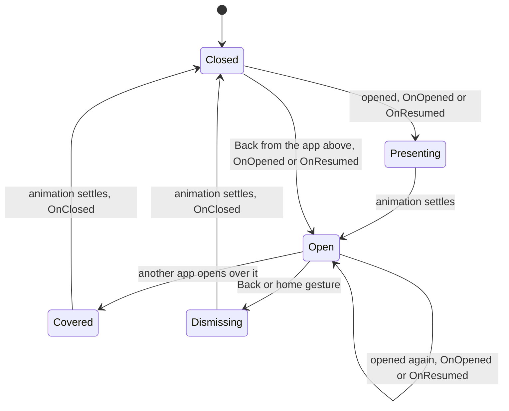

# App framework

This doc explains how the phone hosts an app: the `IPhoneApp` contract and its lifecycle, resuming, navigation, theming, badges, sharing, home placement, launchers, polling, landscape and tours. Read [Creating an app](creating-an-app.md) first for the step-by-step version, and come back here when you need to know when a member is called and what the shell expects of it.

## Key files

| Path | Role |
| --- | --- |
| src/Aetherphone/Core/Apps/IPhoneApp.cs | The contract every app implements |
| src/Aetherphone/Core/Apps/IResumableApp.cs | Optional hook for apps that reopen where the user left them |
| src/Aetherphone/Core/Apps/AppRegistry.cs | Constructs every app once, at boot |
| src/Aetherphone/Core/Apps/NavigationStack.cs | Opens, closes and resumes apps; calls the lifecycle members |
| src/Aetherphone/Core/Apps/ViewRouter.cs | The screen stack inside one app |
| src/Aetherphone/Core/Shell/ShellScreenPainter.cs | Calls your `Draw` each frame and catches its exceptions |
| src/Aetherphone/Windows/Components/Layout/AppHeader.cs | The collapsing large title and its back control |
| src/Aetherphone/Windows/Components/Skin/AppSkin.cs | The per-app painter for backdrop, cards and controls |
| src/Aetherphone/Core/Sharing/ShareService.cs | The share sheet's targets and hand-off |
| src/Aetherphone/Core/Home/HomeLayoutService.cs | Which apps are installed and where their tiles sit |
| src/Aetherphone/Core/PhoneServices.cs | The services apps take as constructor arguments |

## How the shell hosts an app

Every app is constructed once, at plugin boot, in `AppRegistry.BuildDefault`, with the services it needs from `PhoneServices`. `PhoneShell` owns the apps for the life of the plugin and disposes them at unload.

While an app is on screen, `ShellScreenPainter` runs every frame. It picks the theme, fills the screen unless the app wants a transparent one, works out the content rectangle between the status bar and the home indicator, and calls `Draw` with a `PhoneContext`. If `Draw` throws, it logs the exception, draws a short failure message, and calls `Draw` again next frame. The context is rebuilt every frame; copying its theme and navigator into fields for helper methods in the same frame is the normal pattern (ClockApp does it).

## The contract

src/Aetherphone/Core/Apps/IPhoneApp.cs lists the members; most have a default. This table holds what the interface does not show:

| Member | What the code does not show |
| --- | --- |
| `Id` | Keys the accent, icon files, saved layout, flags and deep links. Never rename a shipped id |
| `OnOpened` | Fires on every open, again when the current app is opened again, and when Back returns to it. Make it safe to repeat |
| `OnClosed` | Fires when the close animation settles, not at the gesture, so `Draw` runs a few more frames first |
| `Draw` | Also runs while the app slides in or out, and is called again after an exception |
| `BadgeCount` | Read every frame on the home screen, so return a field. 0 hides the badge |
| `HasBadge` | False means the badge always shows. True adds a Badges switch to the app's Settings page |
| `WantsSystemTheme` | False means the app always gets the dark theme |
| `IsAvailable` | Read every frame on the home screen, so keep it cheap |
| `TileEffect` | Read every frame on the home screen. `Glow`, `Aura` (accent motes) or `Spectrum` (rainbow glints) marks a new app |
| `OnShare` | Called before the app opens, not after |

The server can switch an app off. The default `IsAvailable` then returns false, which hides the tile and blocks opening it. A new app is on until the server says otherwise, and overriding `IsAvailable` opts out of the switch.

## Lifecycle

`NavigationStack` calls the lifecycle members. Opening an app starts a present animation and Back or the home gesture starts a dismiss. When an animation settles, the app that left the screen gets `OnClosed`, including an app that another app just covered.



### Resuming

An app that should reopen where the user left it implements `IResumableApp` and adds `OnResumed`. Each close stamps the time. An open within ten minutes of that close calls `OnResumed` instead of `OnOpened`, and Back into a resumable app always resumes. A resumed visit keeps its scroll position, and the App Switcher lists every resumable app inside the window; swiping a card away forgets the stamp.

Every app is resumable by default. Leave an app plain only when leaving it has to end a live session: Games closes the running game and leaves its rooms, Casino resets its machines and cashier, and Camera releases its capture hooks and the landscape turn. A new app follows the same rule, and `ResumableAppsTests` pins the three that stay plain. A plain app still gets an App Switcher card inside the same window, drawn as its icon and name rather than a live preview, and the card opens it fresh through `OnOpened`. A resumable app follows three rules:

- Reset its router in `OnOpened` only, so a resume lands on the same screen.
- Consume launcher intents and shares in both `OnOpened` and `OnResumed`, or in `Draw`. MessageApp routes both through one method.
- Keep `OnResumed` cheap: a refresh and pending intents, nothing that rebuilds what the user expects to find.

### Optional interfaces

| Interface | What it gives the app |
| --- | --- |
| `ITabRouteTarget` | `OpenTab(tab)`, called before the app opens when a widget targets one tab. Store it in a `PendingTab` and take it in `Draw` |
| The `ISpotlight` hooks | Let Spotlight search list and open the app's content. The first registered app implementing each hook owns it |

## Navigation

There are two layers, and they never mix:

1. **Between apps and home**, through `INavigator` (`context.Navigation`). `Open(appId)` does nothing when the target is not installed or not available. `Back()` returns to the previous app or home.
2. **Between screens inside one app**, through a private `ViewRouter` the app owns.

`ViewRouter<TView>` stacks views of any type: an enum for small apps, a route type for larger ones. `Push` slides a screen in and `Pop` slides it back. `Pop(false)` removes the top screen at once; use it when the data behind the screen changed or vanished (a deleted photo, a submitted form), because an animated pop keeps drawing the outgoing view. `Replace` swaps the top view in place and `Reset` returns to the root.

The large title from `AppHeader` frames each screen. `BeginLargeTitle` returns a frame whose `Body` you pass to `AppSurface.Begin`, so the body scrolls under the bar and the title collapses with it. `EndLargeTitle` draws the bar after the body, with up to two round buttons and, when you pass `onBack`, a back control. Pass a delegate that pops your router on pushed screens and null at the root.

`AppHeader.Draw` is a separate compact bar with a centered title and a back chevron, used by a few sub-screens that are not router levels (chat thread sub-screens, the image picker, the Games online room). New screens use the large title.

### Example: a two-screen app

A list screen pushes a detail screen. The app keeps a `ViewRouter<RecipeScreen>`, an `AppSkin`, and the theme and navigator from the last context. Both delegates are cached in the constructor, because a lambda or method group passed to `router.Draw` allocates a new delegate every frame:

```csharp
public RecipeApp()
{
    drawView = DrawView;
    back = () => router.Pop();
}

public void Draw(in PhoneContext context)
{
    theme = context.Theme;
    navigation = context.Navigation;
    ui.Theme = theme;
    ui.Backdrop(SceneChrome.ScreenFrom(context.Content, theme, UiScale.Current));
    router.Draw(context.Content, AppSkin.Transparent, ImGui.GetIO().DeltaTime, drawView);
}

private void DrawView(RecipeScreen screen, Rect area, int depth)
{
    ui.Body(area);
    var context = new PhoneContext(area, theme, navigation);
    var navBar = AppHeader.BeginLargeTitle(context, depth > 1);
    using (AppSurface.Begin(navBar.Body))
    {
        DrawScreen(screen);
    }

    var title = screen == RecipeScreen.List ? DisplayName : Loc.T(L.Recipes.Today);
    AppHeader.EndLargeTitle(in navBar, context, "recipes.nav", title, NavBarStyle.From(ui),
        ReadOnlySpan<NavBarButton>.Empty, depth > 1 ? DisplayName : string.Empty, depth > 1 ? back : null);
}
```

`ui.Body(area)` paints each view's own background, so views stay opaque during the slide. `DrawScreen` draws the list, and a row tap calls `router.Push(RecipeScreen.Detail)`. This app is not resumable, so `OnOpened` and `OnClosed` both call `router.Reset()`. `L.Recipes` stands in for real keys; NotesApp and ClockApp are full references.

## Theming

Most apps paint their own dark gradient. `AppPalette` is a readonly struct of colors, `AppPalettes` holds one preset per themed app, and `AppSkin` paints with it: construct it once, assign `ui.Theme = context.Theme` each frame, then call `ui.Backdrop`, `ui.Body`, `ui.Card` and the button helpers. [Design accents](design-accents.md) explains where accents and palettes come from.

Only apps drawn on plain system surfaces set `WantsSystemTheme => true`: Settings, Notes, Calendar, Maps, Photos and Announcements. The others always get the dark theme, because the gradient backdrops are designed against dark chrome.

## Badges

The home tile reads `BadgeCount` every frame and draws the badge when the count is above zero and the user has not turned it off; `BadgeAsDot` draws a dot instead of the number. A folder sums its apps' numbers. Real badges are cheap reads of counters the app already keeps (MessageApp adds unread messages to missed calls) and never check the user's preference, because the tile does that. See [Notifications](notifications.md).

## Showcasing a new app

An app listed in `HomeLayoutService.ArrivingApps` stays out of the known baseline, so the first time the server switches it on it lands in the first free home slot on every phone, new and existing alike, and the player can remove it. `TileEffect` makes the tile stand out while it is new. Love Island drives `Aura` and `Glow` from its campaign. Prism shows `Spectrum` for three days from the first time its tile is drawn and drops to `Glow` once the player opens it (`PrismShowcase`).

## Receiving shares

A source app offers an item (Photos offers a photo), and `ShareService` lists every other app that is installed, available, and has the item's kind in `AcceptedShares`. When the user picks one, the service calls `OnShare(item)` and then opens the app. So `OnShare` must only store the item, in a field that survives what `OnOpened` resets; consuming it in `Draw`, as AethergramApp and SettingsApp do, works for a fresh open and a resume alike. A `ShareItem` carries a local file path, not bytes.

## Home screen placement

`HomeLayoutService` owns the home screen. A saved layout lists the installed apps, so an existing profile gains a new app only when the user installs it from the App Store, which adds the tile to the last page. A profile with no saved layout installs every available app and places them from the curated `DefaultDockApps`, `DefaultFirstPageApps` and `DefaultSecondPageApps` lists; apps on none of them go on the last page in name order. A few system apps, such as the App Store and Settings, cannot be uninstalled. [State and persistence](state-and-persistence.md) says where the layout is saved, and [Widgets and Control Center](widgets-and-control-center.md) covers the other home screen pieces.

## Cross-app launchers

Apps never call into each other. To deep-link, a source writes an intent into a launcher service, opens the target by id, and the target consumes the intent when it comes to the front: a `Request` method stores the value and the matching `TryConsume` method returns it once. `PhoneServices` creates every launcher. The general ones live in src/Aetherphone/Core/Apps:

| Launcher | Opens |
| --- | --- |
| `DmLauncher` | ChocoChat to a user, a conversation or the Calls tab |
| `GramDmLauncher` | An Aethergram direct message, optionally with a draft |
| `SocialLauncher` | A profile, post or requests screen in a social app |
| `VelvetLauncher` | Velvet to a user |
| `SettingsLauncher` | Settings to the Notifications, Privacy, Calls or Changelog page, or to one app's own page |

`LaunchIntent` (one pending string) and `LaunchFlag` (one pending bool) give a new launcher that shape for free. Add a launcher rather than public methods on the app class; when a widget only needs to open one tab, `ITabRouteTarget` is lighter.

## Polling from Draw

Immediate mode has no timers, so periodic work runs from `Draw` with `RefreshCadence`: `Advance(delta, interval)` adds the frame time and returns true from the moment the interval has passed until you call `Reset`, so do the work and reset in the same branch. Keep it for cheap local work; network polling belongs in stores ([Networking](networking.md)).

## Landscape

`AppLandscape.Request(Id)` turns the phone sideways while your app is current, `Release(Id)` gives the rotation back (call it in `OnClosed`, so the next visit starts upright), and `Held(Id)` tells you whether you hold it. The shell dismisses the Control Center and the App Switcher while it is held. Camera, Games, Strats, Casino and the AetherStream theater use it. The turn takes a moment, so lay out for landscape only when `Held(Id)` and `context.Content.IsLandscape()` are both true, as GamesApp does.

## First-open tours

Most apps play a short coachmark tour on first open. Tours are data in the TourRegistry partial files in src/Aetherphone/Core/Onboarding, built from `GuideStep` factories, with copy in `L.Onboarding`. Steps point at UI by anchor key, and the app reports each rectangle while drawing with `UiAnchors.Report(key, rect)`. A tour starts on open unless tutorials are off or the user finished that version; raising the version replays it. `TourRegistryTests` pins each tour's version, step count and the number of tours ([Creating an app](creating-an-app.md) has the steps).

## Gotchas

- **`OpenApp` skips the install and availability checks.** Only `Open(appId)` refuses an app that is not installed or is switched off; call it rather than `OpenApp` from app code.
- **An intent nobody consumes waits.** A launcher holds its request until something calls `TryConsume`, so a target that misses it acts on it at a later, unrelated open.
- **A second implementer of a Spotlight hook is ignored.** Only the first registered app that implements each hook is asked.
- **A throwing `Draw` throws every frame.** The failure message hides the crash from the user but fills the log; watch it during development.
- **Resetting the router in `OnClosed` breaks resuming.** A resumable app that resets there always reopens at its root.

## Related docs

- [Creating an app](creating-an-app.md): the tutorial that applies this contract
- [Widgets and Control Center](widgets-and-control-center.md): home widgets and Control Center tiles
- [UI toolkit](ui-toolkit.md): the component library, typography and spacing
- [Architecture](architecture.md): plugin boot, services and the frame loop
- [State and persistence](state-and-persistence.md): where the layout and app data are saved
- [Notifications](notifications.md): channels, deep links and badges
