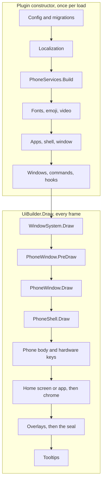

# Architecture

This page is the big picture of the Aetherphone client: what the plugin builds when Dalamud loads it, how the services are wired, which work runs on which callback, and how one frame travels from Dalamud down to a single app's draw call. Read it after [Getting started](getting-started.md) and before your first change outside one app. It covers the plugin only; the Aethernet service lives in its own repository, and [Networking](networking.md) covers the client side of it.

## Key files

| Path | Role |
| --- | --- |
| src/Aetherphone/Plugin.cs | The entry point: builds everything at boot and releases it on unload |
| src/Aetherphone/Core/PhoneServices.cs | The composition root that builds every shared service once |
| src/Aetherphone/Core/Apps/AppRegistry.cs | Builds every app and hands each one its services |
| src/Aetherphone/Windows/PhoneWindow.cs | The one borderless ImGui window the phone lives in |
| src/Aetherphone/Core/Shell/PhoneShell.cs | The per-frame orchestrator: body, content, chrome, overlays |
| src/Aetherphone/Core/Shell/ShellOverlayCoordinator.cs | Overlay order and who owns the pointer |
| src/Aetherphone/Core/Shell/ShellScreenPainter.cs | Paints the home screen or the open app into the screen |
| src/Aetherphone/Core/Runtime/FrameworkTicker.cs | Periodic work on the game's framework tick |
| src/Aetherphone/UiScale.cs | The only place that reads Dalamud's global UI scale |
| src/Aetherphone/Configuration.cs | Every saved setting, in one Dalamud config object |

## The layers

Each layer only talks to the one below it:

```text
FFXIV
 └── Dalamud            plugin host: game services, Dear ImGui, windows
      └── Plugin        entry point: config, services, fonts, windows, hooks
           └── PhoneWindow     one borderless window, sized like a phone
                └── PhoneShell        chassis, status bar, overlays, navigation
                     ├── HomeScreen          app grid, widgets, folders
                     └── IPhoneApp.Draw      the app that is open
```

Every frame, the window calls the shell, and the shell decides whether the home screen or an app paints the screen. An app never reaches up: everything it uses arrives through its constructor or the context it is drawn with.

## Boot and the frame path

The plugin's life has two halves: the constructor, once per load, and the draw callback, every rendered frame.



### Boot

The constructor runs six phases in order:

1. **Config.** `ConfigMigrations.Run` rewrites the raw config file where types moved, Dalamud loads the `Configuration`, and its `Migrate*` methods reshape older data. [State and persistence](state-and-persistence.md) covers both stages.
2. **Localization.** The saved language loads. On the first run the plugin picks one from the game client language, then the OS language, then English, and saves it.
3. **Services.** `PhoneServices.Build` constructs every shared service (next section).
4. **Fonts and media.** The font service, the emoji catalog, and the video suite start. Plugin also subscribes a few handlers of its own to the game tick, for example for video, calls, and the seasonal theme (`OnSeasonTick`).
5. **Apps and shell.** The Linkpearl pop-out windows come first, because the Linkpearl app takes them. Then `AppRegistry.BuildDefault` builds every app, and the shell, the window, and the chat commands follow.
6. **Windows and hooks.** Every window joins Dalamud's `WindowSystem`, the background services start (timers, reminders, alarms, calls), and the plugin hooks the server info bar, the context menu, the chat commands, and `UiBuilder.Draw`.

If any step throws, the catch block calls `TearDownPartialConstruction` to release what was built, then rethrows so Dalamud reports the real error. `Dispose` releases everything in roughly reverse order when the plugin unloads or reloads.

The constructor can run off the game's main thread, so it never reads live character state; [Game integration](game-integration.md) explains how the plugin defers that work.

### Services: one composition root

`PhoneServices` is a single class of `required` init-only properties, built once by `PhoneServices.Build` in dependency order: themes, game data, and the notification pipeline first, then the Aethernet session, HTTP, and caches, then the feature services. It is not a service locator. Nothing looks a service up at runtime; `AppRegistry.BuildDefault` passes each app the services it needs through its constructor, and the shell does the same for its parts. Settings and Notifications, which reach into nearly every service, take the whole `PhoneServices` object.

Plain constructor calls are deliberate: the construction order reads top to bottom in one method, a missing dependency is a compile error, the wiring needs no reflection, and `PhoneServices.Dispose` tears down in roughly reverse order on every reload.

`PhoneVisibility` breaks the one construction-order cycle. Services built before the window exists hold it and later ask whether the full phone is on screen or where its frame is; Plugin binds those probes once the window exists. A handful of statics on Plugin (`Plugin.Cfg`, `Plugin.Fonts`, and a few more) serve draw paths that would otherwise thread a parameter through dozens of constructors.

## Threads and callbacks

Two Dalamud callbacks drive the plugin:

- **`IFramework.Update`** fires once per game tick on the game's framework thread. Work that reads game memory on a schedule belongs here, and so does anything that must keep running while the phone is minimized or closed: activity tracking, alarms, reminders, call timeouts.
- **`UiBuilder.Draw`** fires once per rendered frame while ImGui builds its draw data. Plugin subscribes the window system and a few other per-frame hooks to it. Every ImGui call happens inside this callback.

Network and disk work runs on background tasks started with an explicit discard (`_ = Task.Run(...)`), and the next frame reads the result from a field. Code that needs the framework thread marshals onto it the way `Configuration.Save` does: on the framework thread it writes at once, anywhere else it queues the write with `RunOnFrameworkThread`.

`FrameworkTicker` is the standard way to run periodic work. It subscribes to `Framework.Update`, skips ticks until its interval has passed, and checks an `AppGate`, so work for an app the player has removed from the phone never runs.

### Worked example: a background service

The Calendar reminders show the whole pattern. Plugin constructs the service with a gate for the Calendar app, and the service owns a one-second ticker (src/Aetherphone/Core/Notifications/CalendarReminderService.cs):

```csharp
public CalendarReminderService(Configuration configuration, IFramework framework,
    NotificationService notifications, AppGate gate)
{
    this.configuration = configuration;
    this.notifications = notifications;
    ticker = new FrameworkTicker(framework, TickIntervalMilliseconds, OnTick, gate);
}

public void Dispose()
{
    ticker.Dispose();
}
```

Plugin passes `services.Installer.Gate("calendar")` as the gate. Each tick, `OnTick` walks the saved events, posts a `PhoneNotification` for each due reminder, and, when it handled one, calls `configuration.Save()`, which writes at once because the tick runs on the framework thread. Plugin disposes the service in both `Dispose` and `TearDownPartialConstruction`, so a reload never leaves a second ticker running. A new background service follows the same steps.

## One frame, step by step

Every frame while the phone is open:

1. Dalamud fires `UiBuilder.Draw`, which runs `WindowSystem.Draw`.
2. `PhoneWindow.PreDraw` advances the frame clock, lets the shell advance the minimize morph and the orientation turn (`PhoneShell.PrepareFrame`), publishes the phone zoom for layout and fonts, and sets the window size and position.
3. `PhoneWindow.Draw` computes the device rectangle and calls `PhoneShell.Draw`.
4. `PhoneShell.Draw` draws the minimized phone and returns early while the phone is minimized or morphing. Otherwise it draws the phone body, advances navigation and the loading screen, handles the hardware keys and the resize grip, and asks `ShellOverlayCoordinator.Assess` which layer owns the pointer. Then it draws the content, the chrome (status bar and home indicator), and the overlays.
5. The content step paints one of three things: the app switcher, a running open or close transition, or the resting screen through `ShellScreenPainter.PaintCurrent`. At rest that is the home screen, or `PaintApp` for the open app.

`PaintApp` hands off to `PaintAppSurface`, which fills the screen background (unless the app asks for a transparent screen), insets the screen into the app's content rectangle, and calls the app inside a try block:

```csharp
var contentRect = ContentRect(screen, theme);
try
{
    using (AppVisits.Enter(app.Id))
    {
        app.Draw(new PhoneContext(contentRect, content, navigation));
    }
}
catch (Exception exception)
{
    AepLog.Error(exception, $"[shell] app-draw {app.Id} threw");
    DrawAppFailure(contentRect, content);
}
```

`PhoneContext` is everything an app receives: the rectangle it may draw in, its resolved theme, and a navigator. The content rectangle is already inset below the status bar and above the home indicator. [App framework](app-framework.md) covers the `IPhoneApp` contract, navigation, and transitions.

Besides the phone, the window system holds a few small windows: the update chip, the hunt marker chip on the game's area map, the photo and video pop-outs, the video debug panel, and the Linkpearl and message pop-outs. The in-world video screen is not a window; it hooks `UiBuilder.Draw` directly.

## Overlays and draw order

ImGui draws later calls on top, so the call order in `ShellOverlayCoordinator.DrawOverlays` is the z-order. From bottom to top it draws the top strip (the notification banner, the Dynamic Island, and the status pills), the alarm and incoming call screens, the app switcher, Control Center, toasts, the share sheet, the report and confirm dialogs, the onboarding guide, the account notices, and the coin bursts.

An overlay paints in one of two ways. Some, such as the confirm dialog and the alarm screen, open their own child window over the screen. Others, such as the notification banner and Control Center, paint on ImGui's foreground draw list, clipped to the screen. The foreground list renders after every window, so the call order holds within each kind, and a foreground overlay always covers a child-window overlay.

Two layers sit above all of that, both on the foreground draw list:

- **The seal.** `DeviceChrome.SealScreen` draws the rounded screen corner mask and the brightness veil last among the overlays, so no content can show outside the rounded screen.
- **Tooltips.** After the overlays and the live glass bezel band, `PhoneShell.Draw` ends with `HoverTooltip.Flush`. Tooltips are the top layer, so they can extend past the screen edge.

Two states cut the list short. While the boot screen is up, it draws and returns, so only the seal appears above it. While the first-run setup flow is up, only toasts, the ban notice, and the confirm dialog draw above it.

Overlays also own input. `Assess` runs before the content each frame, and the shell draws the content inside `InputShield.Engage`, so while any overlay holds the pointer, the layers underneath still draw but stop reacting to hover and clicks.

## Scaling

The whole UI is authored for a phone 360 units wide and drawn larger or smaller as one unit, so a 720 wide phone shows the same layout at twice the size, not more rows. Two factors multiply:

- `UiScale.Global` is Dalamud's global UI scale.
- `UiScale.Phone` is the phone zoom, the phone width divided by 360, published by `PhoneWindow.PreDraw` each frame.

`UiScale.Current` is their product, and every design unit in draw code is multiplied by it (`44f * UiScale.Current`). UiScale.cs is the only file allowed to read `ImGuiHelpers.GlobalScale`, and CI enforces that. Text follows the same zoom through the font service, which scales the fonts without rebuilding the atlas.

Dalamud's window API is the one exception. `Window.Size` is given in unscaled units and Dalamud multiplies it by the global scale, while `Window.Position` is raw screen pixels. The size the phone window sets already includes the zoom, so converting it to pixels uses `UiScale.Global`. Using `UiScale.Current` there counts the zoom twice and misplaces the window at any phone width other than 360:

```csharp
var viewport = ImGui.GetMainViewport();
var scaledSize = size * UiScale.Global;
Position = viewport.Pos + (viewport.Size - scaledSize) * 0.5f;
```

For the same reason, the chassis metrics (bezel and rail widths) are built from the 360 design width, never the live width; the draw-time scale grows them. PhoneScalingTests in src/Aetherphone.Tests checks that the chassis, the screen aspect, and the home grid stay proportional across phone widths and global scales.

## Where new code goes

The layering rule decides most placement questions: code under src/Aetherphone/Core and src/Aetherphone/Windows never imports the `Aetherphone.Apps` namespace. The two composition roots, AppRegistry.cs and Windows/Widgets/WidgetCatalog.cs, are the only exceptions, and CI enforces the rule. It keeps the platform buildable and testable without any app.

- **A new phone app** goes in its own folder under src/Aetherphone/Apps/ and is added to `AppRegistry.BuildDefault`. [Creating an app](creating-an-app.md) walks through it.
- **A service** that several apps share, or that must run while its app is closed, goes in Core and is built in `PhoneServices.Build`.
- **A reusable widget** goes in Windows/Components/. [UI toolkit](ui-toolkit.md) lists what exists.
- **A home screen widget** lives with its app and is registered in WidgetCatalog.
- **Core needs something an app provides:** declare an interface in Core and let the app implement it. The Spotlight search sources (the `ISpotlight*` interfaces in Core/Apps) work this way.

## Folder map

The folders of src/Aetherphone/Core, grouped by purpose. Each holds the models, stores, and services for its area; browse a folder for the details.

| Group | Folders |
| --- | --- |
| Device platform | Apps (contracts, registry, navigation), Shell, Home, ControlCenter, Onboarding, Runtime, Animation, Theme, Input |
| Settings and text | Config, Localization, Emoji |
| System services | Notifications, Sharing, Confirm, Report, Commands (the chat command catalog), Platform (file pickers, server info bar), Updates, Changelog, Device |
| Online | Aethernet (the API client), Net (HTTP, caches, retries), Crypto, Telephony, Translation, Moderation, Conduct |
| Social apps | Social, Message, Muster, YellowPages, Announcements, Feedback |
| Game data | Game, GameChat, Contacts, Jobs, Inventory, Wallet, Market, Maps, Timers, Collections, Geography |
| Game companions | Hunts, Fishing, Housing, Strats, Venues, Honorific, Lodestone, News, Dailies |
| Media | Video, Songs, Playback, Radio, Jam, Audio, SystemMedia, Lyrics, Rolladeck, Media, Photos, Wallpapers |
| Personal tools | Activity, Health, Calendar, Clock, Notes, Calculator, Shortcuts |
| Games and coins | Games, Casino, Coins, MoogleClicker |

A few files such as PhoneServices.cs and FontService.cs sit at the root of Core. Outside it, Apps holds one folder per app, and Windows holds the phone window, the pop-outs, the widget library in Components, and the home widget chrome in Widgets.

## Gotchas

- **An app that throws in Draw does not crash the plugin, but it logs every frame.** The shell catches the exception and paints a failure message, so a broken app looks stuck while it floods the log. Search the log for `[shell] app-draw`.
- **A new overlay goes inside `DrawOverlays`, before the seal.** Open a child window over the screen, or paint on the foreground draw list clipped to the screen, and the seal rounds its corners. On the phone window's own draw list it lands under the app, which draws in a child window. Anything painted on the foreground list after the seal can show outside the rounded screen.
- **A ticker gated on an app does nothing while that app is removed.** If a periodic service never runs, check the app id passed to `AppInstaller.Gate` before you debug the timer.
- **`Configuration.Save` off the framework thread returns before the write happens.** On a shutdown path, or wherever losing the change would hurt, call `SaveNow`, which writes synchronously.
- **A long first boot is usually the font atlas.** The boot screen waits at the emblem until every font is built, up to a fixed cap, so it is not a hang.

## Related docs

- [Getting started](getting-started.md): build, load, and reload the plugin.
- [App framework](app-framework.md): the app contract, navigation, theming, and badges.
- [UI toolkit](ui-toolkit.md): the widget library, typography, spacing, and input.
- [Game integration](game-integration.md): reading and acting on the game safely.
- [State and persistence](state-and-persistence.md): the configuration, migrations, and per-character data.
- [Networking](networking.md): the Aethernet client and the realtime connection.
