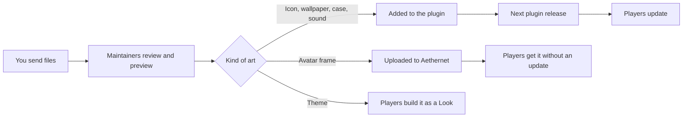

# Art guide

This guide is for illustrators, designers and sound designers who want to make something for Aetherphone, the smartphone plugin for Final Fantasy XIV. You do not need to code, and you never need to open a code file. It covers what you can make, where the exact specs and self-check tools are, how to name and send your files, the rules on rights and AI, and what happens after you send. For color choices (app hues and the accent palette), read [Accent colors](design-accents.md). For mock-ups, the interface font is Inter, and the [theme spec](https://aetherphone.net/theme-spec/) lists the fixed screen palette.

## What you can make

- **App icons**: the painted tiles on the home screen, one per app.
- **Wallpapers**: a Light and a Dark image that sit behind the home screen.
- **Phone cases**: a painted skin around the phone, credited to you in Settings.
- **Avatar frames**: a decorative ring drawn around a player's round profile picture.
- **Themes**: a wallpaper pair, a case, an accent and an icon style that belong together. A theme is a recipe, not a file.
- **Sounds**: ringtones, notification sounds, and the short sounds the interface and games play.

Some parts of the phone are not open for art:

- The mini-games and the seasonal scenery (skies, moons, bats, mist) are drawn in code, so there are no image files to replace.
- Emoji are Twemoji, and the small glyphs inside apps come from icon fonts. Both are used as published.
- The Aetherphone logo and plugin icon are the project's own marks.

## Specs and checkers

Icons, wallpapers, cases and frames each have a spec page on aetherphone.net with exact sizes, guide templates to download and a pre-flight list, plus a checker page that tests your file against the same rules in your browser. Themes have a guide page with a recipe card, and sounds have the rules [below](#sounds). Run the checker before you send: a clean run saves a round trip.

The website copies the list of apps and their colors from the phone by hand, so it can lag behind. Where the two disagree, the phone is right. In particular, the icon checker warns that some real ids (newer games, seasonal icons) are "not a shipped app id": if the id matches a pair in the Icons folder (see [Naming](#naming)), ignore that one warning. For a seasonal file, the id is the part before `.halloween`. If an app's color on the website differs from its current tile, ask the maintainers which to use.

| Art | What you deliver | Spec | Checker |
|---|---|---|---|
| App icon | Two 512 x 512 PNGs: the finished tile and the symbol file. Paint at 1024 and export at 512. | [icon-spec](https://aetherphone.net/icon-spec/) | [icon-checker](https://aetherphone.net/icon-checker/) |
| Wallpaper | Two 1290 x 2796 JPEGs, one Light and one Dark | [wallpaper-spec](https://aetherphone.net/wallpaper-spec/) | [wallpaper-checker](https://aetherphone.net/wallpaper-checker/) |
| Phone case | One 1500 x 2755 PNG with transparency, plus a 375 x 689 thumb | [case-spec](https://aetherphone.net/case-spec/) | [case-checker](https://aetherphone.net/case-checker/) |
| Avatar frame | One 512 x 512 PNG or WebP with a transparent middle, still or looping | [frame-spec](https://aetherphone.net/frame-spec/) | [frame-checker](https://aetherphone.net/frame-checker/) |
| Theme | A recipe card: name, Light and Dark wallpaper, case, accent, icon look, appearance | [theme-spec](https://aetherphone.net/theme-spec/) | [Theme preview](https://aetherphone.net/wallpaper-checker/#theme) in the wallpaper checker |
| Sound | One lossless WAV per sound | [Sounds](#sounds) below | None yet |

### Naming

| Art | File names | Example |
|---|---|---|
| App icon | `<id>.png` for the finished tile and `<id>.fg.png` for the symbol | `calendar.png`, `calendar.fg.png` |
| Wallpaper | `<Name>Light.jpg` and `<Name>Dark.jpg`, the same Name in PascalCase with no spaces | `HarborLight.jpg`, `HarborDark.jpg` |
| Phone case | `<CaseId>.png` and `<CaseId>.thumb.png`, PascalCase letters and digits | `NightBloom.png`, `NightBloom.thumb.png` |
| Avatar frame | Any name; the maintainers rename it | |
| Sound | The name players should see, with underscores for spaces | `soft_bell.wav` |

The file names in the [Icons folder](../src/Aetherphone/Icons) of this repository are the current list of app ids; it is newer than the list on the icon spec page. Four pairs there (phone, contacts, findpeople, kupoai) belong to no app today, so do not paint them. A new app gets its id from the maintainers.

Wallpaper, case and sound names are permanent: every player's settings store the one they picked, so renaming a file after release resets everyone who chose it. Choose them once.

### Sounds

There is no sound spec page yet, so these are the rules:

- Send a lossless WAV at 48 kHz. The phone's sound tools trim, fade and set the final loudness, so leave the level natural and avoid heavy limiting.
- Interface and game sounds are mono and short. Most are under half a second; only a few win fanfares and seasonal cues run 2 to 4 seconds. Start the sound at once, with no silence in front, and let it end on silence so it does not click.
- Notification sounds play once. The shipped ones run about 0.4 to 1.2 seconds.
- Ringtones loop until the call is answered or missed, so the end must flow back into the start. The shipped ones run 4 to 12 seconds.
- Say which kind each file is. A ringtone's or notification's file name is the name players see in Settings.

## Seasonal art

During a season the phone can swap an app's icon for a seasonal version. Halloween is the only season today. A seasonal icon is a normal icon pair with the season added to the id: `chirper.halloween.png` and `chirper.halloween.fg.png`. Every icon rule applies to it.

The swap happens only while a player has the seasonal theme on, in Settings > Appearance > Seasonal Theme (Automatic shows Halloween from 15 October to 2 November). If either seasonal file is missing, the app keeps its usual icon. Six apps have Halloween icons today: Chirper, Aethergram, Velvet, Calendar, Camera and Music. The icon checker does not know seasonal names yet, so expect the unknown-id warning described under [Specs and checkers](#specs-and-checkers).

Seasonal sounds play under the same switch, and players can also turn them off alone with Seasonal Sounds in Settings > Sounds. A new season, such as winter, needs engineering work first, so ask before you start one.

## Rights, credit and AI

- **Your rights.** Contributed art stays with the artist who made it, credited where it appears in the plugin, and a fork of Aetherphone may not reuse it ([Trademark policy](../TRADEMARK.md)). Send only work you made yourself, and mention any conditions on how it may be used when you send it.
- **Credit.** Case artists are named on the case's page in Settings, with a link if they want one, and contributions are usually credited in the in-app changelog of the release that ships them. Tell the maintainers the name and link you want shown.
- **No AI.** AI-generated art and sound are not accepted, with no exceptions. See [AI usage](ai-usage.md).

## Sending your work

When the checker is clean, send the finished files to the maintainers on the [Aetherphone Discord server](https://discord.gg/3HbJCscMyS). Include:

- the files, named as above;
- for a case, its main metal color as a hex value (the case checker suggests one);
- for a theme, the filled-in recipe card from the theme spec;
- the credit name and optional link you want, and a line confirming the work is yours and made without AI.

Questions about fit are welcome before you finish. Send a draft and ask.

## How your art reaches players

Icons, wallpapers, cases and sounds ship inside the plugin, so players get them with the next plugin release. Avatar frames live on Aethernet, the phone's online service, so they need no release; players wear them from the Aether Coin app, under Items. A theme ships no file: no preset Looks exist yet, so players build your recipe themselves in Settings > Appearance > Looks.

## Previewing in game

The checkers are the fastest preview. To see your work in the game itself:

- **Wallpaper**: in Settings > Appearance > Wallpaper, pick the Light or Dark card, then the + tile and Files, to load an image from your PC. An imported wallpaper gets a crop you can move, while shipped ones always crop from the center, so leave the crop centered to see what players will see.
- **Ringtone or notification sound**: Settings > Sounds > Ringtone (or Notification Sound) > Import from PC plays your file as the real thing. It takes MP3 or WAV.
- **Icons, cases, frames and interface sounds**: there is no import for these. Send a draft, and a maintainer can load it in a test build and show you how it looks.

## Changes that force a re-export

Some plugin changes make finished art wrong and mean exporting it again:

- **Cases**: the canvas size, the width of the metal band, the corner curve, or where the hardware keys sit.
- **Icons**: the tile size, the corner mask, the keylines, or an app's accent color, because the tile is painted in that hue.
- **Wallpapers**: the canvas size, or the areas the status bar and dock cover.

Ids and names never change after release, so a rename never forces a re-export. Before you start a large set, check the spec page again and ask the maintainers whether a change is planned.

## Glossary

| Term | Meaning |
|---|---|
| Id | The fixed lowercase name of an app, such as `calendar`. Icon file names start with it. |
| Finished tile | The complete icon, painted to all four square edges. The phone cuts the rounded shape itself. |
| Symbol file | The `.fg.png` file: the symbol alone on transparency, in the same spot as on the tile. The phone builds the other icon looks from it. |
| Icon appearance | The look a player picks for icons: Default (your finished tile), Dark, Tinted or Clear. |
| Keyline | The target width or height of an icon's symbol, given on the icon spec. |
| Squircle | The phone's rounded-square shape: a superellipse, not a rectangle with round corners. |
| Accent | A highlight color. Each app owns one from the phone's fixed palette, and players pick their own for the whole phone, from five presets or any hex value. |
| Light and Dark pair | Two images of one wallpaper: Light by day and in Light mode, Dark by night and in Dark mode. |
| Band | The visible metal rim of a case, the only part drawn on the phone itself. |
| Margin | The free area outside the phone on a case canvas, for charms, ears or straps. |
| Cutout | The area inside a case that the screen covers. It must be fully transparent. |
| Bleed | Edge color carried a few pixels past each transparent edge, so the scaled phone shows no dark halo. |
| Straight alpha | Transparency stored apart from color, the usual PNG export setting. |
| sRGB, no ICC | The standard color space, with the embedded color profile removed on export. |
| Look | A saved set of a player's home screen layout, wallpapers, case, accent, icon appearance and mode (Light, Dark or Auto) that they can switch to. |
| Seasonal variant | An extra icon pair with a season in its id that replaces the usual icon during that season. |
