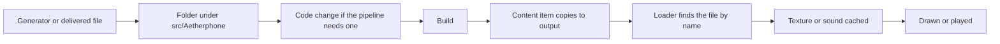

# Assets and media

This page maps every bundled asset pipeline for engineers: fonts and the font atlas, emoji, app icons, brand images, sounds, wallpapers and phone cases. For each one it says where the files live, how they reach the build output, what loads them, and how to add one or land one an artist delivered. Read it before you touch an asset folder under src/Aetherphone or run a generator under tools/. Artists work from the [Art guide](art-guide.md) instead. Avatar frames are not bundled (Aethernet serves them at runtime), so they appear only in the landing table.

## Key files

| Path | Role |
|---|---|
| src/Aetherphone/Aetherphone.csproj | The Content items that copy each asset folder to the build output |
| src/Aetherphone/Core/FontService.cs | Owns the font atlas and its four kinds of font handle |
| src/Aetherphone/Core/IconPlan.cs | The Tabler codepoint block and every FontAwesome icon the source draws |
| src/Aetherphone/Core/Emoji/EmojiCatalog.cs | Loads Emoji/catalog.json and resolves shortcodes to image files |
| src/Aetherphone/Windows/Components/Chrome/AppIconCache.cs | Finds painted icon pairs, swaps in seasonal pairs, bakes icon textures |
| src/Aetherphone/Core/Media/TextureSizes.cs | The 32 to 512 px ladder that icons and the emblem decode into |
| src/Aetherphone/Core/Notifications/UiSound.cs | The catalog that wires interface, game and casino clips to events |
| src/Aetherphone/Core/Notifications/SoundLibrary.cs | Lists bundled and imported ringtones and notification sounds |
| src/Aetherphone/Core/Wallpapers/WallpaperLibrary.cs | Wallpaper discovery, imports, the texture ladder and brightness |
| src/Aetherphone/Core/Theme/ThemeCatalog.cs | The phone case catalog |
| src/Aetherphone/Windows/Components/Chrome/CaseArt.cs | Nine-slices a case skin around the phone |
| tools/ | One generator per pipeline, each with its own README |

## How a bundled asset ships

Every bundled asset is a file in a folder under src/Aetherphone. A Content item in Aetherphone.csproj copies that folder into the build output, and each loader resolves its files at runtime from the folder of the loaded assembly (`Plugin.PluginInterface.AssemblyLocation`). A new or edited file therefore reaches a running plugin only after a rebuild.



| Pipeline | Folder and Content pattern | Loaded by | Built by |
|---|---|---|---|
| Fonts | Fonts/: every `.ttf`, plus the two license texts named one by one | `FontService` | tools/icon-font, for the Tabler subset only |
| Emoji | Emoji/: every `.png` plus catalog.json | `EmojiCatalog`, `EmojiImages` | tools/emoji-generator |
| App icons | Icons/: every `.png` | `AppIconCache` | tools/icon-generator, or delivered art |
| Brand images | Images/: Icon.png and Emblem.png, by name | `BrandMark` | Made by hand |
| Sounds | Sounds/: every `.mp3` and `.wav` in any subfolder | `SoundLibrary`, `UiSoundCatalog` | tools/sound-generator |
| Wallpapers | Wallpapers/: png, jpg, jpeg and bmp | `WallpaperLibrary` | tools/wallpaper-generator, or delivered art |
| Cases | Cases/: top-level `.png` only, so _template never ships | `PhoneCaseTextures` | Delivered art |

The same project file ships the data folders (Words, Hunts, Fishing, Localization; see [Games framework](games-framework.md) and [Localization](localization.md)) and the license texts. THIRD-PARTY-NOTICES.md, LICENSE_ManagedDoom.txt and AlphaChannel-LICENSE are linked into the output root. Fonts/Inter-OFL.txt and Fonts/PirataOne-OFL.txt are named in the Fonts item, and Words/SCOWL-Copyright.txt ships through the Words glob. A new third-party asset needs its license text in that set and its credit in THIRD-PARTY-NOTICES.md.

## Fonts and the atlas

Text renders in Inter, in four weights. `FontService` owns Dalamud's font atlas (the texture that holds every rasterized glyph) and builds four kinds of font handle:

- **Text handles**: one per weight and size tier. A requested scale snaps to the nearest tier, so text is never rasterized at arbitrary sizes. Noto Sans CJK is merged under each to fill what Inter lacks.
- **Shared handles**: two Noto Sans CJK fonts (Regular and Medium) baked once at the largest size for scripts too big to bake per tier. Their glyphs are copied into every text font after each build.
- **Icon handles**: FontAwesome with the Tabler subset merged on top, at a few sizes.
- **Display handle**: Pirata One at one size, Latin only, built only while the Halloween theme is on. `NightWordmark` draws the seasonal wordmarks and blackletter user names with it, and falls back to the normal style for text outside that range.

Draw sites never pass raw sizes. `TextStyles` names the ladder, and each style snaps to a tier:

```csharp
using (Plugin.Fonts.Push(TextStyles.Body.Scale, TextStyles.Body.Weight))
{
    ImGui.TextUnformatted(label);
}
```

Every text handle is baked at the largest zoom and drawn scaled down, so changing the text zoom setting or the phone size never rebuilds the atlas. Which scripts each language bakes up front is planned in src/Aetherphone/Core/Localization/GlyphPlan.cs.

### Learned glyphs

No language bakes the whole Han block, and players write in every script. A draw site that shows user text calls `Plugin.Fonts.NoticeText(text)` before drawing. Each uncovered character joins one learned set shared by every weight and size; once new characters stop arriving for a moment, the atlas rebuilds in the background and `FontService.Generation` moves, so cached text layouts measure again. The learned set persists in the config, so a returning user does not see tofu (the hollow box drawn for a missing glyph). `Typography`, `RichText`, `SoftWrap`, `EmojiText` and the field widgets call `NoticeText` for you.

### Icon font

src/Aetherphone/Fonts/TablerIcons.ttf is a subset of Tabler Icons that tools/icon-font builds together with the `PhoneIcons` constants. The script remaps every glyph into a private block starting at U+E600, because Tabler's own codepoints collide with FontAwesome, and `FontService` never asks FontAwesome for that block, because the first font in a merge wins. Draw a Tabler glyph with `PhoneIcon.Draw(drawList, center, PhoneIcons.Home, color, boxHeight)`; FontAwesome icons go through the widgets that take a `FontAwesomeIcon`.

Every FontAwesome icon the source draws must be listed in `IconPlan.FontAwesomeCodepoints`. An unlisted one is learned on its first draw and costs a full atlas rebuild. `IconFontCoverageTests` checks the list, the bounds of the Tabler block, and that every `PhoneIcons` constant has a glyph in the TTF.

To add an icon glyph:

1. Tabler: add it to `OUTLINE` or `FILLED` in tools/icon-font/generate-icon-font.py and run the script (see tools/icon-font/README.md). Never edit PhoneIcons.cs by hand. Set `IconPlan.LastTablerCodepoint` to the last codepoint the run prints.
2. FontAwesome: add its codepoint to `IconPlan.FontAwesomeCodepoints`, keeping the list sorted.

### Rebuilds and adding a font

Creating or disposing a font handle normally triggers a full atlas rebuild. `FontService` creates dozens, so it wraps the churn in one suppression scope, and any code that creates or disposes several handles must do the same:

```csharp
using (atlas.SuppressAutoRebuild())
{
    Build();
    DisposeHandles(previousText, previousSharedHandles, previousIconHandles);
}
```

To add or replace a font, drop the TTF into src/Aetherphone/Fonts/ (the glob ships it) and point the matching entry of `FontService.WeightFiles` at it, or build a handle of its own as the display font does. Name its license text in the Fonts Content item and credit it in THIRD-PARTY-NOTICES.md. Rebuild and check that the loading screen clears, since it waits on `FontService.Ready`.

## Emoji

Emoji are images, not glyphs: one 72 x 72 Twemoji PNG per emoji sequence in src/Aetherphone/Emoji/, plus catalog.json with each emoji's shortcodes, group, label, search tags and skin tones. Messages store emoji as `:shortcode:` text. The rich text layout turns each shortcode into an inline image drawn through Dalamud's texture provider, and the emoji picker and the suggestions popup read the same catalog. A catalog entry whose PNG is missing draws nothing.

To add emoji, bump the Twemoji or emojibase-data version in tools/emoji-generator, run it, and commit the new PNGs and catalog.json together. Never hand-add PNGs: `EmojiCatalog` trusts file names without checking them. The generator skips PNGs that already exist, so delete one to pick up an upstream redraw (tools/emoji-generator/README.md).

## App icons

An app icon is a pair of files named after the app's id. `<id>.png` is the finished 512 px tile, opaque and painted to the square edges. `<id>.fg.png` is the symbol alone on transparency, in the same position. The plugin cuts the squircle, draws the shadow and lit edge, and bakes the Dark, Tinted and Clear appearances from the symbol file (`IconBake`), so neither file carries corners or effects. `AppIconCache` treats an id as painted only when both files exist, decodes off the main thread into the `TextureSizes` ladder, and drops textures that have not been drawn for a while.

`AppIconTile` resolves an id in this order:

1. **Seasonal pair.** While `SeasonalTheme.Halloween` is on, `<id>.halloween.png` and `<id>.halloween.fg.png` replace the usual pair when both exist. Six apps have one.
2. **Painted pair**, drawn in the player's icon appearance.
3. **Fallback**: the caller draws the accent tile with stencil or procedural art from `AppIconArt`, and last the app's letter glyph.

`AppIconTile.TryDrawGlyph` draws the symbol file alone as a tinted mask for in-app logos, widgets and headers. The folder is not exactly one pair per app: four pairs ship for ids with no app today (phone, contacts, findpeople, kupoai), and rolladeck.png is a partner mark with no symbol file.

To add or land an icon:

1. **Generated**: add the id to the `map` in tools/icon-generator/generate-painted-icons.mjs with the hue of its accent and run the generator for that id (tools/icon-generator/README.md).
2. **Delivered**: drop both files into src/Aetherphone/Icons/ under the exact app id (`IPhoneApp.Id`), or `<id>.halloween` for a seasonal pair.
3. Rebuild. There is no registration step. A brand-new id also needs its app and an accent entry ([Creating an app](creating-an-app.md), [Accent colors](design-accents.md)).

## Brand images

src/Aetherphone/Images/Icon.png is the plugin's installer icon (the manifest points `IconUrl` at its raw GitHub URL), and `BrandMark` also blurs it into the ambient backdrop behind the boot screen, setup and tours. Images/Emblem.png is the transparent emblem drawn on the boot screen and onboarding cards, decoded into the `TextureSizes` ladder so it stays sharp. Both are the project's marks ([Trademark policy](../TRADEMARK.md)), not contribution slots.

## Sounds

Bundled audio lives in five folders under src/Aetherphone/Sounds/, split between two systems:

- **Picker libraries.** Ringtones/ and Notifications/ hold the MP3s that Settings lists. `SoundLibrary`, one per kind, lists the bundled folder plus the files a player imported into the plugin config folder, and saves the choice as a file-name token, so a file name is a persisted value.
- **Event catalog.** Ui/, Games/ and Casino/ hold WAVs wired by path in `UiSoundCatalog`. Each entry carries a gain, a minimum repeat interval and a channel; the Game channel (mini-games and Gamba) follows the Game Sounds toggle. The seasonal `halloween_*` clips live in Ui/ too.

Playback goes through `SoundEffectPlayer`, which picks a decoder by file extension. WAV and MP3 use managed decoders that also work under Wine; anything else falls back to Windows Media Foundation, which is why bundled audio is only `.wav` and `.mp3`. [Notifications](notifications.md) covers when notification sounds play.

Every clip is written by tools/sound-generator/generate-sounds.py, which synthesizes, downloads from pinned sources, and masters the whole set. Its README owns the loudness targets and the steps to add a sound: an event clip needs a generator entry, a `UiSound` member and a catalog line, while a ringtone or notification sound needs only the generator entry, because Settings lists the folder. src/Aetherphone/Sounds/README.md owns the folder checklist: formats, the seasonal clips, default files, retiring a sound, imports, the tests that guard the catalog, and landing a designer's original file.

## Wallpapers

Built-in wallpapers are image files in src/Aetherphone/Wallpapers/, shipped as pairs named `<Name>Light.jpg` and `<Name>Dark.jpg`. `WallpaperLibrary` uses the file name without extension as the id, so the pairing is a naming convention, not code. Players pick a Light and a Dark wallpaper separately, and in Auto mode the Dark one crossfades in at night. A wallpaper a player imports is copied into the plugin config folder with a crop.

Textures are sized to the draw. The library decodes a 640, 1280 or 2560 px copy, or the full file, by the drawn size, because Dalamud's sampler has no mipmaps and should never shrink an image more than about 2:1. It also bakes a small blurred copy that the dock, widgets and folders sample as liquid glass, and scores each image's brightness to set the strength of the home screen scrim behind icon labels.

To add or land a pair, drop both files into the folder (generated pairs come from a palette in tools/wallpaper-generator), rebuild, then check both cards in Settings > Appearance > Wallpaper and the scrim over the brighter file. To remove or rename a pair, add both ids to `BuiltInWallpapers` with replacements so saved settings and Looks migrate; `RetiredWallpaperTests` checks the migration.

## Phone cases

A case is the chassis art around the screen. A `Color` case is a flat procedural tint (Titanium, the default). An `Art` case is a painted PNG skin that `CaseArt` draws under everything else. `CaseArt` nine-slices the skin: the 250 px margin and the corners keep their size while the middle row and column stretch to the phone's aspect, and camera landscape mode draws the same slices rotated. Slicing works in fractions of the 1500 x 2755 template, so a smaller canvas with the same aspect works too (two shipped skins are 1115 x 2048), while a skin with another aspect loads but stretches its corners and margin.

`ThemeCatalog` lists every case. `PhoneCaseTextures` loads `<id>.png` from Cases/ for the skin and `<id>.thumb.png` for the Settings picker, and falls back to the skin when the thumb is missing.

### Worked example: landing a delivered case

An artist delivers NightBloom.png and NightBloom.thumb.png that pass the case checker, the metal color #2E3A59, and a credit name with a link.

1. Drop both files into src/Aetherphone/Cases/.
2. Add one line to the `BuiltInCases` array in ThemeCatalog.cs. The tint is the metal color in 0 to 1 sRGB: it fills the body before the art loads and while cases crossfade, and it tints the glass and the hardware keys.

```csharp
PhoneCase.Art("NightBloom", PhoneCaseCategory.ArtistSeries, new Vector4(0.180f, 0.227f, 0.349f, 1f),
    "Artist Name", "https://example.com"),
```

3. Add the display name: a key in the `Catalogs` class of L.cs, an arm in `CatalogLabels.PhoneCase`, and the same key in all nine language JSONs ([Localization](localization.md)).

```csharp
public static readonly LocString CaseNightBloom = new("catalog.case.nightbloom", "Night Bloom");
```

```csharp
"NightBloom" => Loc.T(L.Catalogs.CaseNightBloom),
```

4. Rebuild, then check Settings > Appearance > Case, the "Design by" credit and its link, the minimize animation, and camera landscape mode.

### The case template folder

src/Aetherphone/Cases/_template holds the guide SVG and two PowerShell scripts. The guide script keeps its own copies of the case geometry, so a change to the canvas, corners, band, glass or hardware keys means updating it and rerunning it, and forces artists to re-export their cases. Its README lists which source files it copies and has the run lines.

## Landing delivered art

| Delivered | Lands in | Code change | Reaches players |
|---|---|---|---|
| Icon pair | Icons/ under the app id | None for an existing app | Next plugin release |
| Seasonal icon pair | Icons/ as `<id>.halloween` | None | Next plugin release |
| Wallpaper pair | Wallpapers/ | None | Next plugin release |
| Case and thumb | Cases/ | Catalog line, L.cs key, label arm, nine JSONs | Next plugin release |
| Sound | Through tools/sound-generator | Generator entry, plus catalog wiring for event clips | Next plugin release |
| Avatar frame | Uploaded to Aethernet by maintainers | None | Without a release |
| Theme | Nothing ships | None | Players build it as a Look |

The website's spec and checker pages mirror some plugin constants (geometry, app ids and hues); maintainers update them when those change.

## Gotchas

- **A painted icon needs both files.** With one missing, the id falls to the stencil path, which tints the whole PNG, so a full-color tile comes out as a flat smear.
- **A full icon generator run overwrites hand-painted icons.** `npm run build` repaints every id in the `map`; take an id out once its pair is hand-painted.
- **Tinted and Clear read the symbol's brightness.** `IconBake` masks with luminance times alpha of the symbol file, so a colored symbol renders at partial strength in those appearances. Keep symbols white.
- **Ids are permanent.** Icon ids, wallpaper file names and case ids are saved in every config, so a rename resets everyone who picked one. Retire through `BuiltInWallpapers` or RetiredSounds.cs instead of renaming.
- **Lookups are cached, misses too.** `AppIconCache`, `PhoneCaseTextures` and the emoji and stencil lookups remember missing files; rebuild and reload the plugin after adding assets.
- **Bespoke text must notice its glyphs.** A custom `AddText` of user text that skips `NoticeText` shows tofu that no rebuild fixes.
- **generate-case.ps1 writes into the shipped folder.** Without `-OutDir` it writes to src/Aetherphone/Cases/, where the build picks the file up; pass `-OutDir` for test cases.

## Related docs

- [Art guide](art-guide.md): what artists deliver, the specs and checkers, rights and the AI rule.
- [UI toolkit](ui-toolkit.md): typography, text styles and the widgets that draw these assets.
- [Accent colors](design-accents.md): the accent ring and the hue each icon tile uses.
- [Localization](localization.md): L.cs, the nine language JSONs, and case names.
- [State and persistence](state-and-persistence.md): the config folder that holds imports and learned glyphs.
- [Testing and release](testing-and-release.md): how landed assets reach players in a release.
