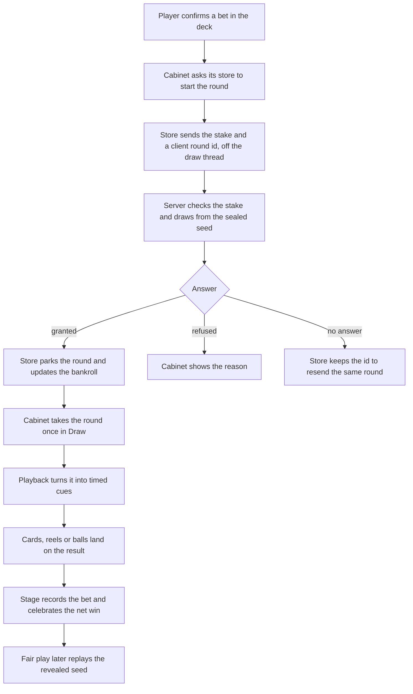

# Gamba

This page explains how Gamba, the casino app, works on the client and how to add a game to it. Read it before you change a cabinet, a table, the cashier or the Floor. Routes and refusals live in [Networking](networking.md).

## Key files

Paths are under src/Aetherphone unless they start with src/.

| Path | What it holds |
| --- | --- |
| Apps/Casino/CasinoApp.cs and its partials | The app: tabs, router, the stage host, the per-game wiring |
| Apps/Casino/Stage/ | The stage kit: frame, spec, stage text, deck actions, celebrations, Get chips |
| Apps/Casino/BetComposer.cs | The bet deck every chip game uses |
| Apps/Casino/DealerHoldem/ | The newest complete game, the one to copy |
| Apps/Casino/CasinoGames.cs, CasinoGameGate.cs | Game ids, and the feature flag each game needs |
| Apps/Casino/Strip/StripCatalog.cs | The Floor's shelves |
| Apps/Casino/Tables/ | Card tables, the host sheet, the door, the ledger pages |
| Apps/Casino/Venue/ | Venue rooms, the Host tab's cards, broadcast, tournaments |
| Core/Casino/CasinoStore.cs, CasinoPlayStore.cs | Floor state, chips in and out, the solo game stores |
| Core/Casino/*Rules.cs, CasinoVerifier.cs | Rules mirrors and the fairness verifier |
| Core/Aethernet/Clients/CasinoClient*.cs, Core/Aethernet/Contracts/Casino*Dtos.cs | Casino routes and wire records, one file per area |
| src/Aetherphone.Tests/Vectors/ | Test vectors shared with the server |

## What Gamba is

Gamba (app id `casino`) is a casino on the phone. Players turn coins from their Aether Coin wallet into chips at the cashier and play every house game from one chip balance: solo games against the house, clocked rooms where everyone bets on the same round, and card tables. Players can also host tables and venue rooms on chips, free play chips or gil.

Terms used below:

- **Bankroll**: the player's chip balance on the floor (a sitting on the wire).
- **Rack**: chips moved from the bankroll to a chip table seat. Leaving walks them home.
- **Ladder**: the fixed steps every chip stake snaps to.
- **Ceiling**: the largest bet the player may place now. The server sends it, and the bet deck never offers more.
- **Host, door, knock**: the host opened the table, the door is the host's console, and a knock asks to join a table that takes knocks.
- **Co-dealer**: a seated player the host promoted to deal.
- **Book**: a gil ledger with no game, for venues running games the app does not have.

## The server decides, the client performs

Every outcome is drawn on the server from a sealed seed. Before a stake is accepted the server publishes the SHA-256 hash of the round's seed (the commit), and it reveals the seed when the round settles. The client only choreographs a result it already holds: reels slow onto the symbols in the answer, a Plinko ball follows its server path, the race ends in the drawn order. The client never fabricates a near miss.

The rule for contributors: no client code computes a payout or picks an outcome. Rules mirrors (client copies of each game's pay tables) only print and replay, and every amount shown after a round comes from the server's answer. Every stake, chip buy and claim carries a client id (`clientRoundId` or `clientActionId`), so a retry replays the request instead of betting twice.



Every game reacts to the answers the same way:

- **Granted**: the cabinet replays the round, and the store updates the bankroll from the stack in the answer.
- **Refused**: `granted: false` with a `reason`. The cabinet shows `CasinoReasons.Text(reason, ceiling)`. Some reasons, such as `invalid_move`, also make it reload the open round.
- **No answer**: the cabinet says the server is unreachable. The store keeps the round's client id (machine rounds save it per character), so the next attempt resends the same round instead of placing a new one.
- **Coming back**: a game whose rounds take several steps reads its open round on entry and resumes it.

## The seven legibility rules

Binding for every cabinet, table and room:

1. The game is the screen. The world (felt, track, reels, board, wheel) fills the stage edge to edge under the glass chrome, with no boxed play area or inset panel. Felt tables are the backdrop, with seats on it.
2. Night, never bright. Backdrops stay at or under 0.22 luminance (`StagePolishTests` pins it). Text sits on a dark backdrop or on glass.
3. Readable text. Body copy at least Subheadline, status lines at least Footnote in strong ink, amounts at least Title3, the main state line ("Place your bets") at least Title2 with a soft shadow. Muted ink only on glass or dark felt. Contrast at least 4.5:1. `StageText` applies these minimums.
4. One obvious next action: one full-width primary in the bet deck, smaller pills beside it. Empty seats are large Sit spots.
5. Use the space: worlds fill the safe area, and no touch target is under 44 units.
6. Clean entry: one tap from the Floor into any game, Back returns where you came from, rules one tap away on the info chip.
7. Every idle state has motion and every state change has feedback.

## Currencies

Only chips touch the casino economy.

| Currency | For the player | For the client |
| --- | --- | --- |
| Coins | The account wallet. Buys chips at 1,000 per coin; chips cash out to whole coins. The daily spin pays coins. | The cashier calls `CasinoStore.BuyChips` and the cash-out methods. |
| Chips | The bankroll, every house game, racks at chip tables. Only chip rounds count for levels, missions, challenges, the club, the Hall of Fame and the jackpot. | The stage capsule shows the stack and its coin value. Stakes snap to the ladder and stop at the ceiling. |
| Free play | Practice chips at hosted tables and venue rooms. No value, and nothing counts. | Grey chips, a practice ribbon, no cashier. Hands stay in the local History and still verify. |
| Gil | The host's own gil, moved by in-game trades. The app keeps a ledger and never holds or converts gil. | Gil is not on the ladder, so gil blackjack bets through `ClassicBetComposer`. |

`CasinoCurrencies.SeatBanked(currency)` is true for free play and gil: the stage then shows the seat's stack, not the bankroll.

## Stores

Each store runs requests off the draw thread through `StoreWork` and parks the answer; the draw path takes it once with a `Take` method, so Draw never awaits. Core/PhoneServices.cs builds them.

| Store | Owns |
| --- | --- |
| `CasinoStore` | Floor state (features, ceiling, max win per bet, bonuses, level), chips in and out, limits, auto top-up |
| `CasinoPlayStore` | Machines, scratch, Barkeep, open-round recovery, and the originals, Plinko and Dealer Hold'em stores |
| `CasinoRoomsStore` | The room list and the live `CasinoRoomSession` |
| `CasinoTablesStore`, `HoldemStore` | Tables, seats, hosting, the door, knocks, ledgers; Hold'em actions |
| `CasinoVenueStore` | Venue rooms and nearby tables |
| `CasinoFloorStore`, `CasinoHistoryStore` | Missions, challenges, Hall of Fame, the bets feed; history and verification |
| `CasinoSpinStore`, `CasinoFameChoiceStore`, `CasinoTradeSync` | The daily spin, Hall of Fame consent, trade sync |

`CasinoRoomSession` applies room events in order, reads the whole room again after a gap or a new epoch, and rides out a server restart behind the reconnect veil.

## The stage kit

Every play screen draws inside one frame, `CasinoStage`. The host in CasinoApp.cs runs it each frame:

```csharp
var frame = stage.Begin(area, ContentWithin(area), spec, StageBalance(route), casino.Ceiling);
DrawStageWorld(route, frame);
var action = stage.End(ui);
```

`Begin` draws the backdrop and the deck and returns a `CasinoStageFrame` (the safe area for the world, the deck rect, the frame time, the Instant and `SnapToTruth` flags). `End` draws particles, the celebration and the chrome, and returns Back, Cashier or Host. A `CasinoStageSpec` declares each screen: backdrop, room ribbon, deck height, free play, bets rail, Instant mode, printed return and an extra info button such as a pay table.

The celebration ladder is the only way to celebrate a win. `stage.Celebration.Celebrate` picks a tier from the net win over the stake: Win, Nice from 3x, Big from 10x, Mega from 25x, Epic from 50x, Legendary from 100x or any jackpot. A payout at or below the stake celebrates nothing. `WinLadder` holds what each tier shows.

`BetComposer` is the bet deck: an amount field with half, double and Max, an optional knob row for the game's own control, auto play, and one primary action. The cabinet passes the ceiling as the maximum, and every amount snaps to the ladder. When a bankroll bet costs more than the stack, the primary becomes Get chips, a one-tap sheet over the stage (`ChipsDesk`).

The stage builds on the Games app's backdrops, particles and seeded randomness; see [Games framework](games-framework.md).

## Playback and fairness

A playback class turns a server answer into choreography and is the only thing a cabinet animates from. It takes the answer (or the room state and server clock), advances each frame, and hands the cabinet cues: a card dealt, a ball landing, a bet resolved, the settle. A snap jumps to the final state for a mid-round join, a reconnect or `frame.SnapToTruth`, which the stage raises after more than two seconds away. Playbacks hold no ImGui state, so `*PlaybackTests` drive them directly.

On the settle cue the cabinet records the bet and celebrates. From Dealer Hold'em:

```csharp
var now = DateTimeOffset.UtcNow.ToUnixTimeMilliseconds();
stage.Settle(new CasinoBetRecord(L.DealerHoldem.Game, round.Stake, round.Payout, round.RoundId, now,
    round.Capped));
if (round.Payout > round.Stake)
{
    stage.Celebration.Celebrate(round.Stake, round.Payout, layout.Hero.Center, instant);
}
```

Rules mirrors (Core/Casino/*Rules.cs) print pay tables, returns, minimum stakes and odds, and help the verifier replay draws. They never decide a payout. When the server changes a game's numbers, the mirror and its tests change in the same release.

Seeded games share test vectors with the server. Each file in src/Aetherphone.Tests/Vectors/ is a byte-for-byte copy of the server's. Its test first pins the file's SHA-256, so a drifted copy fails loudly, then replays every case. Never edit a vector by hand; copy the server's file again.

`CasinoVerifier.Verify` checks a settled round: the revealed seed must hash to the commit published before the stake, and every logged draw must come out of a stream keyed from that seed and the round id. Table hands verify by the room's hand index, venue rolls through `VenueVerifier`. It fails closed: anything it cannot replay is a mismatch. The Fair play page explains this and lets players check their recent rounds.

## The games

Folders are under src/Aetherphone/Apps/Casino.

| Game | Kind | Code | Notes |
| --- | --- | --- | --- |
| Golden Bird Deluxe, Crystal Cascade, Moogle Money | Solo | Machines/ | One machine shell. Every paid spin also draws the floor jackpot. |
| Plinko | Solo | Plinko/ | Each ball follows its server path. |
| Mines, Dice, Limbo, Keno, Hi-Lo | Solo | Originals/ | One cabinet, a skin per game. Mines and Hi-Lo keep an open round. |
| Scratch, Barkeep | Solo | Cabinets/ | Scratch keeps the prize out of the shown balance until every cell is revealed. Barkeep is a skill game with free practice. |
| Dealer Hold'em | Solo | DealerHoldem/ | Poker against the dealer: Ante, Blind, Play and Trips, one decision per street. Also a Play alone card in the Hold'em pit. |
| Wheel, Bingo | Room | Cabinets/ | Clocked rooms. The bingo tumbler is decoration; payouts come from the settled cards. |
| Chocobo race | Room | Race/ | Replays the order and seed revealed when betting locks. |
| Blackjack | Table | Tables/ | House tables at rising stakes, plus hosted tables. Seven seats. |
| Texas Hold'em | Table | Tables/ | House rooms by blinds, plus hosted tables. Player against player. |
| Daily spin | Free | Cabinets/ | Once a day; pays wallet coins. |
| Dice table, Deathroll, Raffle | Venue room | Venue/ | Hosted rooms on free play or gil. |
| Book | Hosted ledger | Tables/ | A gil ledger with trade sync and no game. |

## Hosting tables

The server checks every setting and host action; the client lays out the choices, names conflicts early and shows each answer.

**Opening a table.** The Host tab offers a poster per hostable game, or Host again with the last table's settings. Both open `HostSheet`, which fills a `HostDraft`: the game, Play for (Chips, Free play or Gil; a currency the game refuses is faded and says why), the key numbers as ladder sliders, Who can join (Anyone, Knock or Invite only) and a name. Table rules opens `HostRulesPage` for dealing, turns and limits. `CasinoHostingRules.Check` names a conflict, such as a minimum bet above the maximum, before anything is sent.

**The door.** `TableDoor` is the host's console: the six-character room code with Copy and Copy invite, a card per knock with Let in and Decline, the players with co-dealer and remove actions, and Manage (Pause, Deal next round, Rename, Close). At a chip table the house clock deals, so the door explains why Pause, Deal and co-dealers are missing. At their own table the host gets a Host pill in the top bar, badged with waiting knocks, that returns to the door and keeps the seat. At a Hold'em table a player can send one of six reactions (`casino.react` over the live connection), which everyone else at the table sees.

**The ledger page.** `TableLedger` lists a gil table's entries (in or out, the other side, the kind, the amount, a RECORDED or OWED pill). A tap gives the host the entry's one action: Remove, Mark paid or Mark unpaid. "Missed a trade? Add it by hand" records an entry for a player, or for a guest by character name, since most patrons have no plugin. Players see the rows read only; My gil ledger (`GilLedgerView`) gathers every recent entry they are a side of.

**Trade sync.** Off by default, and shown only to the host of a gil table. While it is on, `TradeWindowReader` reads the game's trade window (read only), `TradeSyncTracker` spots a completed trade that moved gil, and `CasinoTradeSync` sends it; the server decides which ledger entry it becomes. The window is read only while the host is at one of their gil tables (its room, door or ledger page, or its card on the Live and Host pages) or was within the last twelve hours; the table is remembered in the configuration across restarts and forgotten when the host closes it, so a table left open stops picking up the host's unrelated trades, and a trade whose partner name could not be read is never sent. The host sees a "{kind} recorded" card with Undo, and a notification. If recording fails after a few retries, a "Trade not recorded" notification asks the host to add it by hand. Nothing in the game is clicked, and log lines carry amounts, never names.

## The tabs

Gamba has four tabs (`CasinoTab`); every other page is a `CasinoRoute` on the router.

- **Floor** (CasinoApp.Lobby.cs, Strip/): resume card, chips hero with Get chips, level card, claims and daily streak, shortcuts, the Cards, Slots and Quick bets shelves, the jackpot marquee, live rooms, and the Fair play and loss limit links.
- **Live** (CasinoApp.Live.cs, Live/): big wins, join by code or invite, your table, clocked rooms, challenges, house tables and player tables.
- **Host** (CasinoApp.Host.cs, Venue/): your open table, or Host again and the game posters, then My gil ledger.
- **Cashier** (CashierPanel.cs): both balances, Buy chips or Cash out, one coin field and a confirm sheet. Partial cash out needs the `cashier.partial` feature. Every stage's chips capsule opens the same panel as a drawer.

The bonus claim and daily spin home widgets live in Apps/Casino/Widgets/.

## Adding a game

The server ships the game first: wire kind, routes, feature flag and, for a seeded game, a vector file. The client then follows the path Dealer Hold'em took:

1. **Id and flag.** Add the id to `CasinoGames`. The wire kind must be `casino.` plus the id: `CasinoWire.Kind` builds it that way and mission text maps it back. Keep the flag name beside the mirror (`DealerHoldemRules.Feature` is `dealer.holdem`) and map it in `CasinoGameGate.FlagFor`.
2. **Wire.** Records in a new Core/Aethernet/Contracts/Casino(Game)Dtos.cs file with every field defaulted, each registered in `AethernetJsonContext`, and routes in a new `CasinoClient` partial. Pin paths, kind, flag and JSON in a `*WireContractTests` class. A new refusal reason goes in `CasinoReasons` with its own message.
3. **Mirror.** Core/Casino/(Game)Rules.cs with the pay tables, minimum stake and printed return, pinned by `*RulesTests`.
4. **Store.** A solo game gets its own store owned by `CasinoPlayStore`, like `CasinoDealerHoldemStore`; a clocked room extends `CasinoRoomsStore`. Hold the client round id until an answer arrives.
5. **Verifier and vectors.** Teach `CasinoVerifier` the kind and its draw purposes (Dealer Hold'em reuses the Hold'em shuffle). Copy the vector file into src/Aetherphone.Tests/Vectors/, list it as copied content in Aetherphone.Tests.csproj, and add a `*VectorTests` class.
6. **Cabinet.** A folder Apps/Casino/(Game)/ with the cabinet (`Draw(stage, frame, ui)`, a spec, `Enter`, `Reset`, `ICabinetIdle`), a playback class, a tested layout struct and art. Stake through `BetComposer`; settle and celebrate as shown above.
7. **App wiring.** In CasinoApp.cs: construct the cabinet and add it to `DrawStageWorld`, `StageSpecFor`, `OpenGame` and `ResetCabinetOf`; handle its extra info button in `HandleStageRequests`; add a `StageBalance` branch only for a stack other than the bankroll.
8. **Floor.** A `StripCatalog` entry (a clocked room goes in `CasinoApp.LiveRooms`), a `CasinoSign` word, the name in `CasinoGameNames`, rules in `CasinoRules`, a glyph in `CasinoGlyphs`, an accent in `CasinoArt`, and the minimum stake and return in CasinoApp.Floor.cs. Update the shelf counts `CasinoFloorLayoutTests` pins.
9. **Copy.** Every string in L.cs and all nine locale files in one commit (see [Localization](localization.md)). Game names never take an "Aether" prefix.

## Tests that guard Gamba

- `*RulesTests` pin each mirror's tables and published returns.
- `*VectorTests` (with `RaceVectors` and `SlotsVectorTests`) pin each vector file's hash and replay it.
- `*WireContractTests` pin routes and JSON; `CasinoReasonCoverageTests` fails when a reason lacks its own message.
- `CasinoFeatureGateTests` checks that an older server keeps the original games open and closes the newer ones.
- `*PlaybackTests` check cue order, snapping and mid-round joins.
- The layout tests keep zones apart at several UI scales; `CasinoFloorLayoutTests` also checks every playable game is reached exactly once.
- `StagePolishTests` holds the luminance ceiling, `CasinoLightsTests` the neon glyphs, `CasinoVerifierTests` the fail-closed verdicts.

## Gotchas

- Vector hashes are taken with carriage returns removed. Hash a refreshed file the same way, or the pin fails.
- `CasinoFloorLayoutTests` reflects over every `CasinoGames` constant. An id on no shelf and not a live room fails unless it joins the test's unlisted ids, like the venue rooms and the Book.
- `frame.SnapToTruth` is true for one frame only. Act on it in that frame (Dealer Hold'em snaps its playback, card flights and chip flights at once), or the snap is lost and a returning player watches a stale animation catch up.
- A new flag does not need to join `CasinoFeatureSet.Known`: `Has` also finds names outside that list, which is how Dealer Hold'em's flag works.
- Play casino sounds through `CasinoSfx`, not `UiFeedback`: it stays silent while the stage is hidden or the game is out of focus, and lets big wins share one sound slot.
- A sign word may only use letters the neon font defines: A to Z, digits, apostrophe, hyphen, exclamation mark and space.

## Related docs

- [Games framework](games-framework.md): backdrops, particles and seeded randomness under the stage.
- [Networking](networking.md): casino routes, refusals, sessions and the realtime socket.
- [Game integration](game-integration.md): reading game windows and the housing position safely.
- [Notifications](notifications.md): turn, knock and trade notifications.
- [Testing and release](testing-and-release.md): how CI runs these tests.
