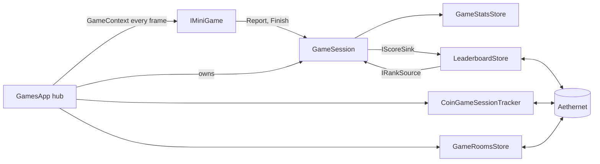

# Games framework

This page explains how the Games app works: the hub and its tabs, the stage kit (the shared framework in src/Aetherphone/Apps/Games/Framework that hosts every mini-game), how a run is scored and recorded, the daily challenge, the leaderboard as the plugin sees it, and the online rooms. Read it before you change the kit or the hub, and next to [Building a game](building-a-game.md) when you write your first mini-game. It assumes you know the phone's app contract from [App framework](app-framework.md).

## Key files

| Path | What it holds |
| --- | --- |
| src/Aetherphone/Apps/Games/GamesApp.cs | The hub: tabs, routing, the list of games, the running game and its session, the daily pick |
| src/Aetherphone/Apps/Games/GamesLibrary.cs | The catalog behind every hub page: release dates, recents, shelves, best cards |
| src/Aetherphone/Apps/Games/Framework/IMiniGame.cs | The contract every mini-game implements |
| src/Aetherphone/Apps/Games/Framework/GameSpec.cs | What a game declares once, and the backdrop presets |
| src/Aetherphone/Apps/Games/Framework/GameSession.cs | One run: the flow states, reporting, finishing, levels, hot-seat handoffs |
| src/Aetherphone/Apps/Games/Framework/GameOutcome.cs | What a game hands the session when a run ends |
| src/Aetherphone/Apps/Games/Framework/GameContext.cs | The data a game receives every frame |
| src/Aetherphone/Core/Games/GameStatsStore.cs | Local records, level stars, the daily challenge and its streak |
| src/Aetherphone/Core/Games/LeaderboardStore.cs | The upload queue, your ranks, and the boards |
| src/Aetherphone/Core/Games/ScoreStatIds.cs | The catalog of ranked stat ids |
| src/Aetherphone/Core/Games/GameRoomsStore.cs | Online rooms: your room list, joining, actions, the live room |
| src/Aetherphone/Apps/Games/Online/OnlineRoomView.cs | One online room: the lobby, the roster, and the table for its game |

## How it fits together

The whole arcade is one phone app. `GamesApp` implements `IPhoneApp` and holds every local mini-game in a plain array built in its constructor. A game exists because a line there constructs it, and that line alone puts it in the Library, on its genre shelf and in search. Local games run entirely on the client. The hub around them talks to the Aethernet server for four things: coins for play time, the featured daily game, the opt-in leaderboard, and online rooms. A game itself never touches the network.



The hub owns one `GameSession` for the open game. Every frame it draws the backdrop, builds a `GameContext` and calls the game's `Draw`, then draws the HUD the game filled (the score pill and capsules over the game), the screen effects, the overlay for the session state, and the back and pause chips. The game reports its score and finishes once. The session writes the local records and hands the run to the leaderboard store through `IScoreSink` and reads ranks back through `IRankSource`, two small interfaces that tests replace with null versions.

`AppRegistry.BuildDefault` constructs the hub once:

```csharp
apps.Add(new GamesApp(services.GameStats, services.GameData, services.Textures, services.Coins,
    services.CoinSessions, services.GameRooms, services.Configuration, services.Leaderboard,
    services.RemoteImages, services.Lodestone, services.MoogleClicker, services.SettingsLauncher,
    services.Confirm));
```

Most games take no constructor arguments. A game that needs a service gets it from the hub, as Trivia takes the game's data sheets and Lander the texture provider. If the hub does not hold the service yet, add it to this call and to the `GamesApp` constructor.

## The hub

The hub is split across partial files of `GamesApp` (GamesApp.Home.cs, GamesApp.Library.cs and so on), with shared components in src/Aetherphone/Apps/Games/Hub. Its root has four tabs:

| Tab | What it holds | Route id |
| --- | --- | --- |
| Home | The daily challenge hero, Continue Playing, Just Added, Top This Week, one shelf per genre | `games.tab.home` |
| Together | Your online rooms, join with a code, start a room | `games.tab.together` |
| Library | Every game in one grid, with search, genre chips and a sort menu | `games.tab.library` |
| Profile | Your stats, the daily streak calendar, your ranks, your personal bests | `games.tab.records` |

`GamesLibrary` is the catalog behind every page. Its `Releases` table dates each game, which drives Just Added and the New label; it keeps every list as reusable index arrays so the draw code never allocates, and builds each best card in `BestRecord`. The route `games.play.<id>` opens a game directly, as the Daily Game widget does.

Two versioned feature pins in src/Aetherphone/Core/Changelog/NewFeaturePins.cs put a dot on the Games icon and the What's new card on Home. A key a player has seen never shows again, so a release that announces new games gives both pins new keys.

## The game contract

Every mini-game implements `IMiniGame` (src/Aetherphone/Apps/Games/Framework/IMiniGame.cs):

```csharp
internal interface IMiniGame : IDisposable
{
    GameSpec Spec { get; }
    string Id => Spec.Id;
    string Title => Loc.T(Spec.Title);
    GameGenre Genre => Spec.Genre;
    Vector4 Accent => AppAccents.For(Spec.Id);
    void Start(in GameStart start);
    void Close();
    void Draw(in GameContext context);

    void DrawIdle(in GameContext context)
    {
    }

    void OnQuit(GameSession session)
    {
    }
}
```

The host calls `Start` on Play, Play again and Restart, with a `GameStart` holding the mode, seed, daily flag, level and player count. `Draw` runs every frame from the countdown to the result card, and the game keeps its state in fields, since Dear ImGui redraws everything each frame. `DrawIdle` is an optional preview under the intro. `OnQuit` runs on every exit and restart, even after the run ended, `Close` when the hub closes the game, and `Dispose` when the plugin unloads.

`Accent` and the other members with bodies are default interface members, which C# does not expose inside the implementing class. Every game draws with its accent, so every game declares `public Vector4 Accent => AppAccents.For(GameId);`, as WhackApp.cs does.

The kit owns the frame and the game owns the world. The host draws the backdrop, intro, countdown, pause menu, result card, HUD layout and the back and pause chips, and records the result. The game supplies its world, its rules, this frame's HUD values and its effects. Its `GameContext` carries:

- `Full`, the whole content rect for backdrops and worlds, and `Safe`, inset below the HUD band, for boards.
- `DeltaSeconds`, the simulation delta: clamped, zero unless the session is playing and the phone has focus, and slowed by slow motion. `RawDeltaSeconds` keeps running while paused, for entrances and effects.
- `Session`, `Hud`, `Fx` (screen effects), `Backdrop`, `Theme` (for kit pieces such as `GamePad` that take one), and `ChromeHit(pointer)`, which says whether a click landed on the back or pause chip.

### The spec

A game declares one `GameSpec` as a static field. The fields that matter most:

| Field | What it decides |
| --- | --- |
| `Id` | The key for records, the accent, the icon and the release date |
| `Title`, `Hook` | The localized name, and the one-line how-to-play on the intro |
| `Genre` | The shelf: Arcade, Action, Puzzle, Brain, Strategy or Tabletop |
| `Backdrop` | The animated stage under everything: Nebula, Sky, Felt, Meadow, Neon, Cavern or Slate |
| `Hud` | Standard (a score pill with capsules under it) or Compact (one row, for tall boards) |
| `Kind` | How the run's value is stored, compared and shown, see [Score kinds](#score-kinds) |
| `Modes`, `ModeStatIds` | Difficulty or rule choices on the intro, each with its own stat id |
| `Clocked`, `Countdown` | Losing focus pauses a clocked run; a countdown plays 3, 2, 1 before it |
| `Landscape` | The hub holds the phone sideways while the game is open |
| `LevelCount` | A hand-made level pack with stars and a level select |
| `Seats` | Up to six players passing one phone |
| `UnrankedModes` | Practice or side modes that never rank |

The rest (a kind, a countdown or a caption per mode, a unit such as Strokes, modes that only apply to solo play) is named in GameSpec.cs.

## Session flow

A run moves through five states. The host draws every overlay; the game only draws its world.

| State | What the player sees | What the game gets |
| --- | --- | --- |
| Intro | Icon, title, hook, best and rank pills, mode and player strips, Play, Leaderboard, Levels | `DrawIdle`, dimmed |
| Countdown | 3, 2, 1, Go over the frozen world, when the spec asks for it | `Draw`, zero delta |
| Playing | The world, the HUD and the chips | `Draw`, live delta |
| Paused | Resume, Restart, Leaderboard, Quit | `Draw`, zero delta |
| Result | Title, value, New Best, rank line, up to four stat lines, Play again | `Draw`, zero delta |

A game calls `Session.Report(score)` every frame, so the score pill rolls and glows while it beats the best, and `Session.Finish(outcome)` once when the run ends. `Finish` records the run by its kind, completes the daily challenge when it applies, hands the run to the leaderboard store and shows the result card. A game never writes records itself.

Leaving a game (Quit, Restart, the back chip, another game, closing the app, unloading the plugin) calls the game's `OnQuit`, then settles any run still going. Settling finishes a Score run with its live score, so an endless game still reaches the boards. Time, Count, Level and Streak runs are never settled: a half-solved puzzle has no honest result. A game with no runs at all (Moogle Clicker never ends) records a best with `Session.Record(statId, value, kind)` instead.

**Level packs.** A spec with a level count gets the level select, star progress, unlocking, and Next level and Retry on the result card. The game reads the level number from `GameStart.Level`, builds that level, and finishes with `WithStars` (zero to three). A level opens once the one before it holds a star, and a Level-kind pack ranks by its total stars.

**Hot-seat.** A spec with more than one seat adds a Players strip to the intro, and the count arrives as `GameStart.Seats`. Between turns the game calls `Session.Handoff(seat)`: the host covers the screen with "Pass to Player 2" in that seat's color and freezes the game until a tap, so hidden cards never show to the wrong player. A run with more than one local player always finishes unranked.

## Scoring

### Score kinds

| Kind | Better | Shown as | Example |
| --- | --- | --- | --- |
| Score | Higher | A number | Whack, Tetris |
| Time | Lower | m:ss | Sudoku, Sweeper |
| Count | Lower | A plain number with the spec's unit | Mini Golf strokes |
| Level | Higher | A level, or a star total for a level pack | Water Sort, Crates |
| Streak | Higher, and a loss resets it | A number | Chess, Reversi |

A lost Time or Count run records nothing (the Sudoku you gave up on), and a draw leaves a streak where it was; both still count for the daily challenge. One spec can mix kinds per mode: Solitaire's Classic is a Time, its Vegas mode a Score.

A stat id is the game id, optionally with a tier or mode suffix such as `sudoku.easy`. An outcome can add a secondary stat (Pairs records its attempts next to its time). All local records live in `GameStatsStore`, which saves through the plugin configuration (see [State and persistence](state-and-persistence.md)).

### The daily challenge

One game a day is the daily challenge. The hub takes the featured game from the coin wallet when the player is signed in and the wallet names a known game; otherwise it uses `CoinGames.FeaturedFor(day)`, a fixed rotation over the client's `CoinGames.All` list. The day turns at 15:00 UTC, with the coin day.

The daily game is seeded with `GameSeed.Daily(id, day)`, so everyone plays the same board, and Play again keeps that seed. Any finished run of it completes the challenge, a loss or an unranked run included. Consecutive days grow the streak shown on Home, on Profile's calendar and on the Daily Game widget.

## The leaderboard, from the client's side

The leaderboard is a social feature: it moves no coins, unlocks nothing and awards nothing. It is opt-in. The first time a signed-in player opens Games, a consent card previews their row and offers Join leaderboards or Not now; Not now leaves a small Join card on Home, the leaderboard and Profile. Settings > Privacy holds the same choice as Show me on leaderboards. Signed-out players keep their records on the phone.

Every finished ranked run goes to `LeaderboardStore`, which keeps the best value per stat id in a queue saved with the configuration, so it survives a sign-out and a reload. Once the account has joined, the store uploads the queue in the background, and joining also queues the phone's existing bests. Leaving clears the queue. The server decides which scores it accepts; the client uploads honestly and shows the reply.

Only stat ids in `ScoreStatIds.Catalog` rank. A tier or mode id without its own row folds onto its game's root when the kinds agree, so `chess.easy` ranks as `chess`; anything else never uploads, and its intro reads Not ranked.

The player sees the result in three places. The intro's rank pill reads "#12 · Global", Uploading, Leaderboards off, Sign in to rank or Not ranked; the result card's rank line adds the total ("#8 of 1,240 · Global") and reads Kept on this phone when the run stayed local. Tiles, posters and Profile's Your ranks carry rank capsules. The leaderboard screen shows Global or Friends, This week or All time, a podium, and a sticky bar with your own row.

## Online rooms

The Together tab's games are not mini-games. The server runs their rules; the client draws a table from the room state it receives and sends the player's actions back, so they need an Aethernet account. `GameRoomsStore` owns everything online: your room list, creating, joining and leaving, one `Send*` method per action, and the live room, fed by realtime signals with a request fallback while the socket is down. Answers reach the draw code through `Take*` calls, never callbacks. The routes are in [Networking](networking.md).

Each kind has one table class in src/Aetherphone/Apps/Games/Online, picked by `OnlineRoomView`. Tables may reuse the local game's pieces: online Broadside and Mini Golf draw with the offline renderers and replay the shot the server resolved. To add a kind once the server knows it:

1. Add the kind constant to `GameRoomWire`, the room state record to GamesDtos.cs (registered in `AethernetJsonContext`), a field on `GameRoomState`, and its parsing to `GameRoomSession.Build`.
2. Add a `Send*` method to `GameRoomsStore` for each new action.
3. Write the table and dispatch to it from `OnlineRoomView`.
4. Add one `OnlineKindInfo` row (kind, accent id, host hint, seat cap) to `OnlineGameArt.Infos`. Every list of kinds reads it, and `OnlineKindInfoTests` fails until each kind has a row.
5. Add its name to `GamesOnlineText.GameName`, its strings to L.cs and the nine language files, an accent and icon unless it reuses a local game's, and a `Releases` row for `online.<accent id>`.

## Rules that apply only inside games

- **Input capture.** Read the keyboard only through `GameInput`. It raises ImGui's `WantTextInput`, which Dalamud honours by keeping the keys from the game client, and it keeps them for two seconds after the last read, so a key still held when play stops does not jolt the character. `WantCaptureKeyboard` does nothing against the game, so a bare `ImGui.IsKeyDown` read still walks the character.
- **Motion.** The rest of the phone moves on critically damped springs that never overshoot. Games may bounce: `GameJuice.PopIn` overshoots and settles, a curve only games and the casino cabinets use. The kit's own motion and the hub stay on springs.
- **Juice.** Juice is the feedback that makes a hit feel good: particles, shake, hit-stop, flashes. Call `FeedbackFx.ScaleDelta` once per frame with `DeltaSeconds` and feed its result to the simulation only, so a hit-stop freezes the world while effects keep moving on `RawDeltaSeconds`. Effect pools drop entries silently when full, so never hang gameplay on an effect.
- **Stage inks.** The stage is always dark. Draw text on it with `StageInks`, never the theme's text colors, which turn near black in a light theme.
- **Determinism.** Seed every board from `GameStart.Random`, never `System.Random`, so the daily board is shared and a test can replay a run.
- **No allocation per frame.** Use `GameNumber.Label`, `LabelSlot` and `TimeText` for labels, and keep LINQ out of draw and step code.
- **Sound.** Play cues through `UiFeedback.Play` with the game entries of `UiSound`; they sit on a channel players can mute on its own.

## Stage kit map

Every piece below lives in src/Aetherphone/Apps/Games/Framework; open its file for the API. The casino builds on the same kit: its cabinets draw the stage backdrop with the Strip and Arena presets and reuse the effects, see [Gamba](casino.md).

| You need | Use |
| --- | --- |
| A grid of square cells | `GameGrid` |
| A glass board under the grid, and cells with depth | `BoardPlate`, `StageCell` |
| A world bigger than the screen, or one that follows the player | `Camera2D` |
| Bursts, sparkles, confetti | `ParticleSystem` |
| Shake, hit-stop, shockwave rings, floating score text | `FeedbackFx` |
| A flash, a danger vignette, slow motion, a zoom punch | `ScreenFx`, as `context.Fx` |
| A trail behind a fast object, or glowing line art | `Ribbon`, `NeonStroke` |
| A combo multiplier with a draining window | `ComboMeter` |
| "Wave 3" or "Ready" text that holds | `GameBanner` |
| An on-screen d-pad or fire buttons | `GamePad` |
| A drag on the board that must not move the phone | `PressSurface` |
| A fixed tick, or substeps for fast projectiles | `FixedStepClock`, `Substeps` |
| Rigid bodies, hinges, ropes, raycasts | `PhysicsWorld` in the Physics folder |
| Ellipses, concave fills, segment and circle tests | `Shapes`, `Polygon`, `Geometry2D` |
| Hands, piles and flying cards | The Cards folder |
| Destructible terrain, a lane runner, lane defense | `TerrainMask`, `LaneProjection`, `LaneGrid` in the World folder |

## Gotchas

- **Finish once, then stop stepping.** The session ignores a second `Finish`, but `Draw` keeps running while paused and on the result card. Keep your own finished flag and accept input only while `Session.State` is `StageFlow.Playing`.
- **Use `DeltaSeconds`, not `ImGui.GetIO().DeltaTime`.** The IO delta skips the clamp that stops a hitched frame from teleporting the world, the zero while unfocused or paused, and slow motion.
- **The custom HUD slot is one frame behind.** `Hud.Custom(width)` reserves a slot, and `Hud.CustomRect(index)` returns where it landed last frame. Draw into it only when `Hud.CustomPlaced(index)` is true.
- **Camera order matters.** Each frame: fit, then follow, then `context.Fx.ApplyTo(ref camera)`, `camera.Update` and `context.Backdrop.SetCamera(in camera)`, and only then draw. Otherwise the world trails the backdrop by a frame.
- **World-space particles need world numbers.** Draw them with the camera overload of `ParticleSystem.Draw`, and give speed, size and gravity in world units; the defaults are pixels.
- **`GamePad.DPad` reports presses, not holds, and so does `Shooter`'s `Fire`.** Steering while a finger stays down needs `GamePad.HeldDPad`; a held fire key reads `ShooterPadInput.FireHeld` or the held flag of `HoldButton`. Release a held pad when play stops.
- **Physics steps itself.** Call `PhysicsWorld.Step(context.DeltaSeconds)` once per frame: it runs the fixed ticks the frame owes and clears last frame's contact events. Never wrap it in `Substeps` or call it twice. Draw with `RenderPosition`, rule on `Position`.
- **Escape belongs to the game while it holds the keyboard.** The client's system menu opens only after the phone loses focus. That is the intended trade.

## Related docs

- [Building a game](building-a-game.md): the step-by-step tutorial for a new mini-game.
- [App framework](app-framework.md): the phone app contract the hub implements.
- [UI toolkit](ui-toolkit.md): the buttons, rails and text the hub pages use.
- [Gamba](casino.md): the casino, which shares the stage kit.
- [Networking](networking.md): the score and room routes and the realtime socket.
- [Testing and release](testing-and-release.md): the test project that holds every board, kit and hub suite.
