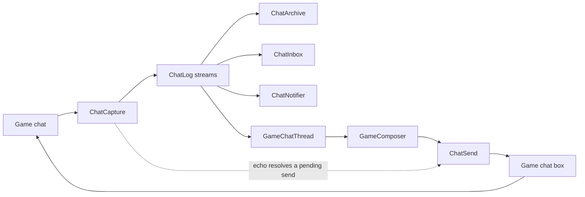

# Linkpearl

Linkpearl is the phone app that shows the game's own chat (tells, party, free company, linkshells, say and the rest) as a list of conversations, and lets the player answer from the phone or from small pop-out windows. Read this page before you change how game chat is captured, stored, shown or sent. "Linkpearl" is a product name: it reads the same in all nine languages and is never translated. Its app id is `messages`. Linkpearl has no server, so game chat never leaves the PC. The server-backed chat apps are in [Messaging and chat](messaging-and-chat.md).

## Key files

| Path | What it is |
| --- | --- |
| src/Aetherphone/Core/GameChat/GameChannels.cs | The channel catalog |
| src/Aetherphone/Core/GameChat/ChatCapture.cs | The one listener on game chat |
| src/Aetherphone/Core/GameChat/ChatLog.cs | In-memory buffers, one per stream |
| src/Aetherphone/Core/GameChat/ChatArchive.cs | History on disk, retention, export |
| src/Aetherphone/Core/GameChat/ChatInbox.cs | Conversation rows, unread, read watermarks |
| src/Aetherphone/Core/GameChat/ChatSend.cs | Byte budget, pending sends, paced split parts |
| src/Aetherphone/Core/GameChat/MessageSplitter.cs | Cuts a long message into parts |
| src/Aetherphone/Windows/Components/Chat/GameChatThread.cs | The thread screen for the app and every pop-out |
| src/Aetherphone/Windows/Components/Chat/GameComposer.cs | Channel chip, soft-wrapped field, byte counter |
| src/Aetherphone/Apps/Linkpearl/LinkpearlApp.cs | The phone app |
| src/Aetherphone/Windows/LinkpearlPopouts.cs | The pop-out window pool |
| src/Aetherphone/Core/GameChat/PopoutPresence.cs | Hides pop-outs in combat, duties and cutscenes |

## How game chat flows

Each channel is one row in `GameChannels`: key, the game's chat types, send command, label, tint and category. Capture, the send budget, the channel picker and the labels all read that row, so a new channel costs one entry (GameChannelsTests pins the catalog). Battle and loot logs are left out on purpose: they are a log, not a conversation.

`ChatLog` keeps one buffer per stream. A channel's stream key is its channel key; a tell's is `tell:` plus the partner's name@world in lower case, holding both directions. History and the line cap therefore belong to a conversation, not a channel. A tab reads several streams through a `ChatStreamView`, which appends live lines in place and rebuilds only when its set of streams changes.

The game raises chat events on its main thread and ImGui draws on the same thread, so the log, the inbox and the views have no locks. Never touch them from a `Task`.

## Reading game chat safely

`ChatCapture` subscribes once to Dalamud's `IChatGui.ChatMessage` and does nothing unless Linkpearl is installed. It resolves the channel through the catalog, flattens the text (auto-translate phrases included), and keeps links (players, items, map links, statuses, quests, party finder listings, other plugins' links) as `ChatChunk` values, so they render as links and survive in history. It flags the player's own lines and lines that mention the player's name.

Capture only reads, with one opt-in exception: a channel can be hidden from the game's own chat log, which calls `PreventOriginal`. That needs the master switch "Let channels hide game chat" and the channel's own flag, both off by default. System and echo lines can never be hidden, and a message another plugin already handled is left alone.

## Sending game chat safely

Linkpearl sends only in response to the player: Enter, the send button, or Retry. `ChatSender.TrySend` hands the line to the game's own chat box entry point, the path typing takes, so the game's usual rules apply. It refuses an empty line, anything over the game's 500 byte limit, and any text the game's sanitizer would strip characters from, so what goes out is exactly what a player could type. Linkpearl never uses the looser `TrySendSanitised`, which cleans the text instead of refusing it.

- **Budget.** `ChatSend.Budget` subtracts the channel command and, for a tell, the target name. The composer shows a counter ring.
- **Splitting** (on by default). `MessageSplitter` cuts at whitespace where it can, never inside a character, and a typed line break starts a new part. Parts follow at the Composer settings interval, never faster than a quarter second; logout or a failed part stops the queue.
- **Delivery.** A send shows as a dimmed ghost until the game echoes the same text on the same channel. Ten seconds without it shows "Not delivered" with a Retry.
- **Commands.** A draft starting with a channel command and a space (`/p `) switches the composer to that channel when the conversation offers it. Any other draft starting with `/` goes to the game as a command.

The menu on a chat line or a player, item or map link (invite, friend request, plate, target, market and map) uses the game actions in [Game integration](game-integration.md).

## Tabs and tells

A conversation is a tab or a tell, and both are one row in the list. `GameChatTargets.For(row)` turns a row into what the thread opens, so the app and the pop-outs open conversations the same way.

- **Tabs** are player-made groups of channels, with presets for Free Company, Linkshells, Party and Local. Alerts are All, Mentions (the default) or Off (the Local preset's default). A tab's send channel can follow the game chat box's current channel.
- **Tells** are one conversation per partner, started from the new chat sheet, a chat line's menu, or the game's right-click menu on a player when "Linkpearl chat in menus" is on in Settings, General (off by default).

Each conversation shows in Log (one line per message in the game's colours) or Bubbles (the shared transcript). A tab stores its layout; a tell starts in Bubbles. The thread draws only the newest lines and adds a page as the player scrolls up.

## History

`ChatArchive` writes one file per stream into a folder per character (GameChat, then the character's content id in hex, inside the plugin's config folder). Writes are batched. On a character switch it flushes, clears the log, switches folders and loads, in that order.

Retention is per channel: Off, Session (memory only), 30 days (the default) or Forever. All tells share the tell channel's policy. The master switch "Store history on this PC" (also in the phone's Settings, Privacy) turns everything off: new lines stay in memory, and stored files go the next time the character loads. Switching one channel to Off or Session deletes its files at once. A tab's Keep history row writes through to its channels and reads Mixed when they disagree. The player can clear one conversation or everything, or export all history as text and JSON.

## Read state, mutes and alerts

Each conversation has a read watermark in config, advanced only while it is on screen. The thread screen notes the conversation every frame through the same `ViewingMark` the server-backed stores use, so a closed phone stops counting a few seconds after it stops drawing. A pop-out counts only while expanded and hovered or focused, so a collapsed one keeps counting even with the pointer on it. The game has no read receipts, so neither does Linkpearl.

`ChatInbox` (unread) and `ChatNotifier` (notifications) share one rule set, so a line that cannot notify cannot badge: own lines never count, nor do channels set to "Never count as unread", and a Mentions tab counts only mentions.

- **Muting a tell or a tab** keeps a quiet unread dot but never badges the app or notifies. A muted tell never auto-pops.
- **Muting one linkshell.** A tab's info screen gives each channel its own alerts switch, so one noisy linkshell can go quiet inside the Linkshells tab while the rest stays live. Rows show the names the game reports.
- **Pausing** notifications in Linkpearl's Settings silences every alert; a banner on the Chats tab offers to resume.

## Pop-out windows

A pop-out is a floating window that keeps conversations on screen while the phone is closed or minimized. `LinkpearlPopouts` owns a fixed pool of Dalamud windows: up to six pop-outs of up to six tabs each, with a toast at either limit.

A conversation pops out from its action sheet, a new tell, the game's right-click menu, or the hotkey (off by default; repeat presses walk the recent list, and it never fires while a text field has focus). A new conversation joins the most recently active window with room. Drag one pop-out onto another to merge them.

A window re-targets one `GameChatThread` on a tab switch instead of keeping one per tab, because every thread owns a stream view. Only the active tab is attended, so background tabs keep counting unread. Confirms render inside the window that asked. `PopoutPresence` hides windows without closing them, so they keep their conversations, place and unread counts.

| Setting | Default | Notes |
| --- | --- | --- |
| New chats open as tabs | On | Off gives each conversation its own window |
| Pop up new tells while the phone is closed | On | Not while paused, in Do Not Disturb, for a muted tell, or when already open |
| Pop up tells you send too | On | |
| Also while the phone is open | Off | Not when the phone already shows that tell |
| Pop up new tells without switching to them | Off | Adds an unread tab, or raises a window without taking focus |
| Close pop-outs when you log out | Off | |
| Placement | Beside the phone | Or a screen corner; a new window reuses the spot of the last one closed |
| Fade while you are away from it, Flash the bar on a new message | On | Window opacity, idle opacity and text size are sliders next to them |
| Hide in cutscenes, with the HUD hidden, in combat | On | Separate switches |
| Hide in duties | Off | Field operations stay open |
| Bring back afterwards | On | Hidden windows always return; with this on they return at once and show the conversation that got a message |

## Gotchas

- **Wrapped line breaks are not part of the message.** Both composers type into a soft-wrapped copy of the draft, so the ImGui buffer holds breaks the player never typed. `SoftWrapBuffer` merges each edit back onto the real text; only a Shift+Enter break reaches the splitter. Never read the widget buffer as the message or guess breaks by measuring text: that once sent one party message as five.
- **History is a per-channel promise.** A channel shared by two tabs has one history and one policy.
- **Clear the file before the stream.** Clearing a stream only in `ChatLog` leaves its file on disk, and the lines come back on the next load. The app's clear actions delete through `ChatArchive` first, then clear the log.
- **Layout caches sweep, they do not clear.** `RunText` and `RichTextCache` drop only entries idle for more than a frame; clearing everything makes a long history re-wrap every frame.
- **Never focus a pop-out to raise it.** Dalamud's `BringToFront` focuses the window, which ends text input in every other window. A background pop-out raises itself with `ImGuiP.BringWindowToDisplayFront` instead.
- **`MessageArchive` is not dead code.** `ChatArchive` imports tells from that earlier format once per character.

## Related docs

- [Messaging and chat](messaging-and-chat.md): the shared transcript, entrance animation and themes Linkpearl reuses.
- [Game integration](game-integration.md): `IChatGui`, threading rules and the game actions behind the chat menu.
- [State and persistence](state-and-persistence.md): where the config folder lives and how to reset it.
- [Notifications](notifications.md): how a Linkpearl alert becomes a phone notification.
- [Localization](localization.md): product names that are never translated.
