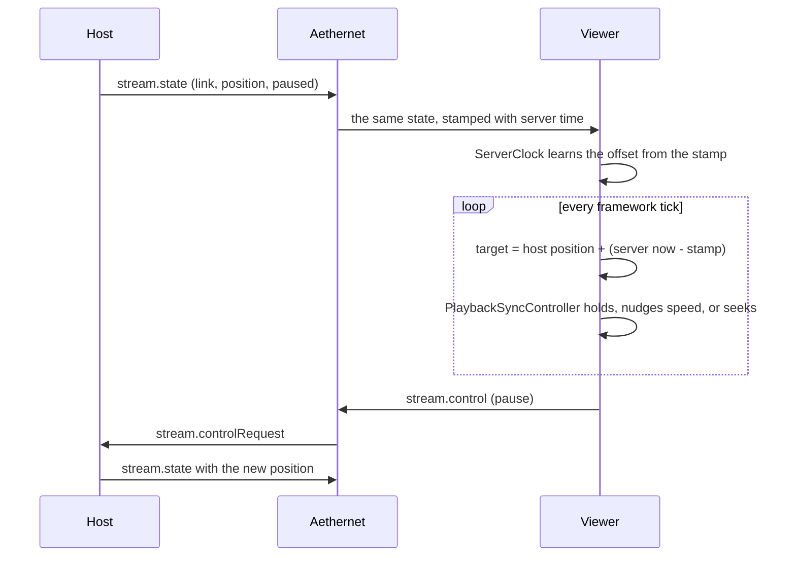

# Media and video

This page explains the media features from the client side: MogCast video and its in-world screen, watch-along parties, Music and its Jam listening parties, world and Community Radio, and the external tools they download. Read it before you change playback, sync, or anything that touches mpv, yt-dlp, or NAudio. Requests and the websocket in general are covered in [Networking](networking.md).

## Key files

| Path | What it is |
| --- | --- |
| src/Aetherphone/Apps/AetherStream/ | The MogCast app (internal name AetherStream) |
| src/Aetherphone/Core/Video/VideoEngine.cs | Playback, the shared video texture, screen placement |
| src/Aetherphone/Core/Video/MpvRenderer.cs | The libmpv wrapper and its threads |
| src/Aetherphone/Core/Video/ScreenPainter.cs | Draws the in-world screen into the game's frame |
| src/Aetherphone/Core/Video/WatchAlongSession.cs | Watch-along parties |
| src/Aetherphone/Core/Video/PlaybackSyncController.cs | Turns drift into a speed nudge or a seek |
| src/Aetherphone/Core/Video/MediaDependencies.cs | Downloads and updates mpv, yt-dlp, and deno |
| src/Aetherphone/Core/Playback/PlaybackHub.cs | Owns the song and radio players |
| src/Aetherphone/Core/Songs/SongPlayer.cs | Song sources, decoding, and output |
| src/Aetherphone/Core/Jam/ | Jam listening parties |
| src/Aetherphone/Core/Radio/ | World radio, Community Radio, and station rooms |

## MogCast video

MogCast is the video app (app id `aetherstream`). It plays a link or a local file on the phone, in landscape theater mode, in a separate "MogCast Screen" window, or on a screen placed in the game world.

### How a frame gets on screen

`VideoEngine` drives libmpv (the library form of the mpv player) through `MpvRenderer`. mpv renders in software on its own thread, and the frame is copied into one shared texture on the game's render thread, because Direct3D work must happen there: `DxHandler` queues the upload and runs it during the game's frame present. Every view draws that same texture. mpv plays the sound itself, and the volume fades with your distance from the in-world screen.

`ScreenPainter` draws the in-world screen straight into the game's frame, using the camera and the scene's depth so anything in front of it hides it. The player places it from MogCast's screen controls, with handles drawn in the world by src/Aetherphone/Windows/VideoWorldOverlay.cs, and the spot is remembered per place. Parts of this engine are ported code under another license; read [Third-party notices](../THIRD-PARTY-NOTICES.md) before you change them.

### Links, failures, and local files

mpv runs yt-dlp through its built-in ytdl hook to turn a page link into a playable stream, and yt-dlp uses deno for the checks some sites ask for. Titles, thumbnails, and playlists come from YoutubeExplode.

When a link fails, `PlaybackFailureClassifier` reads mpv's error lines and names the cause: a sign-in is needed, DRM, a region lock, an unsupported site, a changed site, or a bot check. Each cause gets its own card with Retry and, for the host, Skip. A changed site or a refused stream triggers an urgent yt-dlp update, and a stall watchdog restarts playback where it stopped.

A local file never leaves the PC. The host publishes an `aep-local:` token instead of a path, a fingerprint of the file's start, end, size, and name (src/Aetherphone/Core/Video/LocalMediaIdentity.cs). Each viewer maps it to their own copy; without a match they see a "Locate file" card, and the file they pick is checked and remembered.

## Watch-along parties

A watch-along party lets players watch the same video together: one player hosts, the others view. Party traffic rides the websocket as `stream.*` messages, which `StreamSignalRouter` hands to `WatchAlongSession` for the framework thread.

### The host is the single source of truth

Only the host's player decides what plays. The host publishes `stream.state` (link, position, pause state, screen pose, queue, and the room's rules) whenever something changes, plus a heartbeat every 8 seconds, and never more often than every 250 ms. A viewer with the control permission never touches their own player: they send `stream.control`, the host receives it as `stream.controlRequest`, applies it, and publishes the new state.

### Keeping viewers in sync

The server stamps every state with its own clock. `ServerClock` keeps the last eight "stamp minus local receive time" samples and trusts the largest, because network delay can only make a sample smaller. Each tick the viewer projects where the host is now: the host's position plus the time since the stamp.

`PlaybackSyncController` turns the gap into a correction. Within 0.3 seconds it does nothing. Above that it nudges mpv's speed, up to 5 percent, growing with the gap. Past 3 seconds it seeks to the target, then waits 2 seconds to settle. Speed returns to normal when the host pauses, near the end, or when the last state is too old to trust.

### Joining, handover, and failures

A host can publish a six-character invite code, which works from any world or data center. Players can also find parties in their own zone and world, or through a player's account. A host can require approval. Guests can be allowed to add to the queue or control playback, for the whole room or per member. Party features ride a capability bit, so the client hides them until the server reports it.

The host can hand the room to a viewer who can host (`stream.transfer`). Whenever the host changes, every member receives `stream.hostChanged`, and the viewer it names takes over hosting. After a socket drop, a host republishes at once and a viewer rejoins, retrying while the room is unavailable.

A viewer who cannot play the room's link reports it once, and the host sees a "N of M watching can't play this" card with Skip. When the queue runs out with viewers present, the host keeps the room on a standby screen for five minutes.

## Music

Every song in Music is a YouTube video id played as audio. `SongPlayer` tries an offline download, then the disk cache, then yt-dlp (through `SongLinkResolver`), then YoutubeExplode. Audio is decoded in process (WebM Opus through the managed Concentus decoder, M4A through Windows Media Foundation), mixed, and played through NAudio on shared-mode WASAPI, with waveOut as the fallback.

`PlaybackHub` owns the song and radio players, and only one plays at a time; a call stops both. When the player turns on sharing (off by default), `ListeningPresence` tells Aethernet what they are playing so friends can see it.

### Jam

A Jam is a listening party: a room with a code, a shared queue, a host, and guests. No audio is relayed; every guest plays the same song on their own client. Sync works like a watch-along: the host publishes `jam.state`, and guests project its position with a `ServerClock` and correct with `JamDriftController`. That controller starts sooner, past a fifth of a second, and nudges by at most 3 percent, because changing a song's resampling rate also shifts its pitch. A gap past 1.5 seconds gets a seek.

The server owns the Jam queue: permitted members send changes, and the queue the server returns is the truth. While a Jam runs, `PlaybackHub.Authority` points at the session, so every play, pause, skip, and stop goes to the Jam first.

## Radio

World radio searches the public radio-browser directory (`RadioService`) and plays stations with `RadioPlayer`. The player follows playlist files, handles HLS, sniffs the format, decodes MP3, AAC, and Ogg Opus, shows the stream's track titles, and reconnects after a stall. It uses its own `HttpClient`.

Community Radio stations are run by players. The DJ broadcasts in MP3 from streaming software on their PC, using the connection details their station page in Music shows, and listeners play the stream with the same `RadioPlayer`. Each station also has a live room over `radio.*` messages (chat, reactions, song requests, a pinned notice), which `RadioRoomRouter` drains into `RadioRoomSession` on the framework thread.

## External tools

MogCast and Music download three tools on demand instead of shipping them:

| Tool | What it does | Where it comes from |
| --- | --- | --- |
| mpv (libmpv, LGPL build) | Plays and renders video | The zhongfly/mpv-winbuild releases on GitHub |
| yt-dlp | Turns a page link into a stream, for video and songs | The yt-dlp releases on GitHub, or its nightly builds with Early site fixes on |
| deno | The JavaScript runtime yt-dlp uses for site checks | The denoland/deno releases on GitHub |

Each tool lives in its own folder under aetherstream/ in the plugin's config directory. MogCast shows a setup screen with the download size while any tool is missing, Music asks for yt-dlp and deno the same way, and a first play installs what is missing. A new file is swapped in beside the current one; if that one is in use, it is moved aside and the new file takes over at the next launch.

yt-dlp keeps itself current: a background check runs at most daily, and a changed site or a refused stream triggers an urgent update. mpv and deno update only from MogCast's settings. When a download fails, the setup card shows the error and a Try again button, and nothing retries on its own. A failed background update keeps the installed yt-dlp, and playing without the tools shows "The video components are not installed yet."

## Gotchas

- Run Direct3D work only through `DxHandler.RunOnRenderThread`, and never dispose `DxHandler.Device`: it is Dalamud's device.
- mpv events arrive on mpv's own thread. Queue them for the framework thread; never touch app state inline.
- Set NAudio volume with a `VolumeSampleProvider`, never the output device's `Volume` property, which changes the whole game's volume in the Windows mixer and leaves it changed.
- Never dispose an NAudio output while holding a lock or inside its own stop callback. `SongPlayer` detaches it under the lock and disposes it later on a worker.
- The generated yt-dlp.conf keeps its UTF-8 byte order mark on purpose. Without it, yt-dlp reads the file in the Windows code page, and a non-ASCII profile path breaks every link.
- A replaced libmpv-2.dll takes effect only after the plugin restarts.
- Jam code that stops the player must clear `PlaybackHub.Authority` around its own stop, or the stop loops back into the Jam.
- `WatchAlongSyncTests` pins the clock and drift behavior; change the thresholds together with it.

## Related docs

- [Networking](networking.md): the websocket these parties ride on
- [Notifications](notifications.md): Jam invites and party suggestions as notifications
- [State and persistence](state-and-persistence.md): where settings, downloads, and caches live
- [Assets and media](assets-and-media.md): bundled images and sounds
