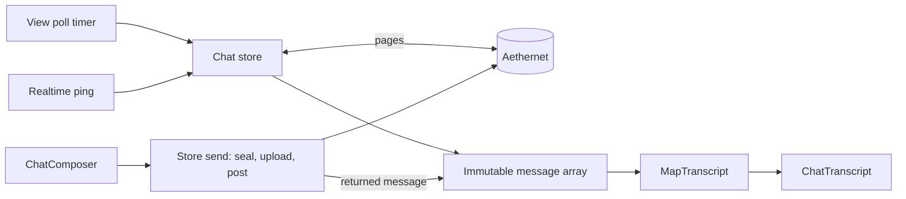

# Messaging and chat

This page explains the shared chat stack behind every server-backed conversation in Aetherphone: ChocoChat (the Message app) and its pop-out windows, Velvet, Aethergram DMs, and Yellow Pages inquiries. Read it before you change one of those screens or build a new one. The in-game chat app has its own page, [Linkpearl](linkpearl.md); the HTTP client, the realtime socket and the cryptography live in [Networking](networking.md).

The UI is Dear ImGui, an immediate mode library: every screen is redrawn each frame, and a "component" here is a class whose `Draw` method you call every frame. Keep work off that per-frame path.

## Key files

| Path | What it is |
| --- | --- |
| src/Aetherphone/Core/Message/ChatThreadStoreBase.cs | Base store: polling, paging, sending, reactions, media, notifications |
| src/Aetherphone/Windows/Components/Chat/ChatThreadView.cs | Base thread screen that wires all the pieces together |
| src/Aetherphone/Windows/Components/Chat/ChatTranscript.cs | The bubble list: grouping, scroll, load-older trigger, read ticks |
| src/Aetherphone/Windows/Components/Chat/ChatComposer.cs | The input bar: draft, reply and edit, emoji, image, location, voice |
| src/Aetherphone/Windows/Components/Chat/ChatMenuController.cs | The message menu and reaction strip |
| src/Aetherphone/Windows/Components/Chat/ChatText.cs | Message kinds, previews, token resolution |
| src/Aetherphone/Core/Aethernet/IdentifiedMerge.cs | The id-keyed merge every page, refresh and push uses |
| src/Aetherphone/Core/Message/ViewingMark.cs | The "on screen right now" mark |
| src/Aetherphone/Core/Message/EncryptedSendPolicy.cs | When a plain text send must be held back |
| src/Aetherphone/Apps/Message/DirectMessagesStore.cs | ChocoChat's store, the reference implementation |
| src/Aetherphone/Apps/Message/MessageThreadViewBase.cs | ChocoChat's view, shared with its pop-outs |
| src/Aetherphone/Windows/Components/Chat/ChatListChrome.cs | Inbox row, header and list styles shared by ChocoChat and Linkpearl |

## Two stacks, one look

The codebase has two chat stacks with one visual language.

- The **server-backed stack** is a store (`ChatThreadStoreBase`) plus a view (`ChatThreadView`). Messages live on the Aethernet server and arrive as DTOs (data transfer objects, the wire records), with replies, reactions, edits, media, translation and end-to-end encryption. This page covers it.
- The **in-game stack** is [Linkpearl](linkpearl.md): real game chat, no server, no reactions. It reuses only the transcript, the entrance animation and the chat themes.

The Music app's `LiveChatTranscript` (radio and jam lobby chat) is a third, smaller surface. Check all three before you build another.

| App (app id) | Thread view | Store |
| --- | --- | --- |
| ChocoChat (`message`) | `ThreadView` in Apps/Message/MessageApp.Thread.cs | `DirectMessagesStore` |
| ChocoChat pop-outs | `PopoutThreadView` in Apps/Message/MessagePopoutWindow.cs | One detached `DirectMessagesStore` per window |
| Velvet (`velvet`) | `ThreadView` in Apps/Velvet/VelvetShell.Thread.cs | `VelvetStore` |
| Aethergram (`aethergram`) | `ThreadView` in Apps/Aethergram/AethergramApp.Thread.cs | `GramDmStore` |
| Yellow Pages (`yellowpages`) | `ThreadView` in Apps/YellowPages/YellowPagesApp.Thread.cs | `AdInquiryStore` in Core/YellowPages |

ChocoChat is the Message app's user-facing name; code and localization keys say `message` and `MessageApp`. `MessageThreadViewBase` holds what its phone screen and pop-outs share: the DTO mapping, saved drafts, the wallpaper, the composer layout and group sender avatars.

A ChocoChat pop-out is a desktop window bound to one conversation. Each window builds its own store with `tracksInbox: false`, so it never polls the inbox or raises a second notification; the phone's store keeps that job. Forwarding, message info, starring and reporting stay in the phone.

Yellow Pages inquiries are the one surface whose thread id is not the other person's id. An inquiry belongs to one ad and one reader, so `AdInquiryStore` maps it to the other user before it resolves the key scope. Inquiries are always sealed and live only as long as their ad.

## How a message flows

The store is the only part that talks to the server. It holds the open thread's messages as an immutable array and replaces the whole array on every change. The view maps that array into transcript rows, and the composer sends through the store.



Three things make the store fetch: the view's poll timer while the thread is on screen, a realtime ping, and a resume (the thread comes back after the view went undrawn for a few frames). A ping merges a pushed message into the array or requests a refresh; [Read state and receipts](#read-state-and-receipts) explains why it never fetches directly.

Sends are not optimistic. The store appends the message the server returns, and the next refresh that carries the same id merges onto it. Only reactions update ahead of the server. When a text send fails, the view shows a toast with the reason and puts the text back into the draft.

Copy-on-write is the contract between store and view. `ChatThreadView` re-runs your `MapTranscript` only when the array reference changes, which keeps the remap off the per-frame path. For inputs that live outside the array, override `TranscriptVersion` to return a counter that changes with them (ChocoChat returns its contact book version, so renamed contacts remap), or call `InvalidateTranscript()` once.

## Anatomy of a thread screen

`ChatThreadView.Draw(Rect area, string threadId, bool activeLayer)` composes the screen top to bottom. Pass `depth == router.Depth` as `activeLayer`: only the route on top of the router stack opens the thread, ticks it and marks it viewed, while a layer underneath or sliding away during a transition only paints.

1. **Thread switch.** A new `threadId` opens that thread in the store, clears the reply and edit targets, closes search, stops voice playback and swaps drafts.
2. **Tick.** Polls the thread and the typing state and sends typing signals (see [Typing](#typing)).
3. **Header.** `DrawHeader` is yours; `ChatHeaderControls` has lock, search and translate buttons.
4. **Search.** Scans only the messages already loaded; it never queries the server.
5. **Banners.** At most one encryption banner, then "May be out of date" with a retry while polls back off, then your `DrawAboveTranscript`.
6. **Backdrop, transcript, composer, menu.** `PaintTranscriptBackdrop` is where ChocoChat paints its wallpaper; the message menu draws last, over everything.

### The transcript

`ChatTranscript` draws a span of `TranscriptMessage`, a flat readonly struct with a flags byte (encrypted, placeholder, deleted, edited and so on). It draws day separators, sender grouping, one bubble renderer per kind, cards for token shares, tappable links that open behind a confirm, the translation footer, the typing bubble and follow-bottom scrolling. It reaches outside through small interfaces on its model (media, interactions, voice, paging, translation), which `ChatThreadView` implements for you. Optional ones add shared-post cards and story replies (Aethergram) and group sender avatars (ChocoChat).

### The composer

`ChatComposer` owns the draft and one reply or edit target. Its layouts are `Bar` (Velvet), `Pill` (Aethergram, Yellow Pages) and `Plus` (ChocoChat, with an attach menu); in each, an empty draft offers a voice note instead of send. Enter sends, Shift+Enter breaks the line, and `ChatThreadView.MessageMax` caps the text. The field is a soft-wrapping `SoftWrapEditor`, so never read the ImGui buffer as the message; [Linkpearl](linkpearl.md) explains that trap.

### The menu and translation

Right-clicking a bubble opens a reaction strip (with a plus for the full emoji sheet) and the actions your `ChatMenuModel` allows. Edit, info and delete appear only on your own messages, translate and report only on other people's, and edit and translate only on plain text. The menu draws on ImGui's foreground draw list, above every widget.

When the server reports translation as available, incoming text can be translated per message from the menu, or for a whole conversation with a per-thread toggle. The first translation shows a one-time disclosure: Aethernet translates the chosen text, and an encrypted message is decrypted on the PC first.

## The message model

| Kind | Meaning |
| --- | --- |
| 0 | Text |
| 1 | Image |
| 2 | System row (for example "added to the group") |
| 3 | Voice note |
| 4 | Shared post |
| 5 | Story reply |

Location, muster and ad shares are kind 0 messages whose body is a token; `ChatText.EffectiveKind` resolves them so menus and previews treat them as cards.

- **Replies** carry a server-made snapshot of the quoted message, so the quote renders even when the original is not loaded. Tapping it scrolls to the original.
- **Edits and deletes.** Only your own plain text can be edited. A delete tombstones the message locally and the bubble shows a muted "deleted" row.
- **Forwarding** seals encrypted text again for the target thread. Encrypted media cannot be forwarded.
- **Media.** Stills are re-encoded to a capped JPEG; a GIF uploads unchanged up to `GifMedia.MaxBytes`. Voice notes record as WAV.
- **Starring** is ChocoChat only and lives in local config.

## Paging

Paging is cursor based. Each page carries its items plus an opaque cursor that the client sends back for the next page; a null cursor means nothing is older. The server decides page sizes, so never assume one.

- `OpenThread` fetches the newest page, `LoadOlder` fetches with the cursor, and `RefreshThread` fetches the newest page again.
- All three merge through `IdentifiedMerge.MergeById`: items missing from the page are kept, incoming items win on the same id, and the result is sorted by time with the id as a tiebreaker. Merging instead of appending lets pages, refreshes and pushes arrive in any order.
- A failed poll backs off exponentially, and the sync banner offers a retry. The thread list pages the same way through `LoadMoreThreads`.

The transcript keeps the viewport still while an older page lands. When the user scrolls near the top, it records the distance from the bottom, then pins the scroll to that distance every frame until the new messages have arrived and the scroll has stuck. A mouse wheel tick can overwrite a pending scroll set, which is why it re-applies the pin rather than setting it once. A timeout releases the pin if the load fails.

## Read state and receipts

- **Ticks.** Your bubbles show one check, then a double check once the server reports the message read. In ChocoChat, receipts flow only when both people keep Read receipts on in Settings, Privacy, so one check can also mean receipts are off. ChocoChat's "online" and "last seen" follow the same mutual rule.
- **Unread counts** come from the server per thread. The store sums them for the app badge, skipping muted threads and the thread on screen, and `NoteThreadViewed` zeroes the on-screen count locally so the row badge drops at once.
- **Fetching the newest page marks the thread read**; older pages never do. For a pushed message merged without a fetch, ChocoChat posts an explicit read with `ChatClient.MarkReadAsync`, only while the thread is on screen.
- **Notifications** skip the thread being viewed, muted threads and the first inbox poll after sign-in. If an encrypted preview cannot be decrypted yet, the banner waits briefly, then notifies anyway.

That read rule has a sharp edge: background code that fetches an open thread silently marks it read. So a ping or timer calls `RequestThreadRefresh`, which only sets a pending flag, and the store consumes it only when `ViewingMark` says the thread was drawn within its short grace window. The view's own poll calls `RefreshThread` directly, which is safe only because it runs on the active layer right after `NoteThreadViewed`.

The inbox polls on a cadence that slows in the background and stretches while the realtime socket is up. Call `NoteInboxWatched` every frame your app (or a home widget showing its list) draws, to keep the list fresh. [Networking](networking.md) owns the cadence.

## Typing

The view sends a typing signal from its tick only when the draft has changed, the trimmed draft is not empty, and the app's typing throttle has passed since the last signal. Each app passes that throttle and its thread poll interval to the `ChatThreadView` constructor. Clearing the draft sends nothing.

While the realtime socket is down, the view polls the other person's typing state on the thread poll cadence. While push is active that poll stops: a pushed signal whose type matches the store's `TypingSignalType`, for the open thread, turns the typing bubble on, and it expires a few seconds later.

## Encryption for store authors

A store picks the key scope for each thread. Whenever the thread is encrypted, the base class seals everything that leaves the device in that scope: message text, edits, media bytes (before the upload) and captions. You supply four pieces.

- `ScopeFor(threadId)`: the key scope string, built with the `ConversationKeyStore` helpers.
- `HydrateKeysAsync`: loads this account's wrapped conversation keys.
- `EnsureThreadKeysAsync`: returns the thread's `ChatKeyStatus` (whether it is known, whether this device can encrypt, the key generation, members without keys).
- `DecorateMessages` and `DecorateThreadList`: swap decrypted text into messages and inbox previews; placeholders show until that succeeds.

Sends wait for the key status. Before every send or edit the base resolves it, and `EncryptedSendPolicy.MustHoldPlaintext` holds back a plain text send when the status is not known yet, or when the thread is encrypted but this device cannot encrypt for it: sending in the clear there would be a silent downgrade. The composer mirrors this, showing "checking" while `KeyStatusPending` is true and blocking while `SendWouldDowngrade` is true. `AdInquiryStore` overrides `SendWouldDowngrade` so its composer stays blocked whenever it cannot seal. Keys, envelopes and recovery are in [Networking](networking.md).

## Adopting the stack

A surface that talks to Aethernet needs two subclasses and reuses everything else.

**1. The store.** Subclass `ChatThreadStoreBase<TMessage, TThread>`; both types implement `IIdentified` (an `Id` string). You write the transport verbs and field accessors and inherit polling, backoff, paging, merging, reactions, tombstoning, sealed media upload, notifications and report evidence. Most overrides are one line, as in this excerpt from `DirectMessagesStore`:

```csharp
protected override string ImageUploadScope => "chat-dm";
protected override string VoiceUploadScope => "chat-voice";
protected override string ReportTargetType => "chat_message";
protected override string TypingSignalType => Core.Telephony.Contracts.SignalType.ChatTyping;

protected override string ScopeFor(string threadId) => ConversationKeyStore.ChatScope(threadId);

protected override Task HydrateKeysAsync(CancellationToken token) => keys.HydrateAsync(token);

protected override Task<ChatKeyStatus> EnsureThreadKeysAsync(string threadId, CancellationToken token) =>
    keys.EnsureChatKeysAsync(threadId, token);

protected override async Task<MessagePage?> FetchMessagesPageAsync(string threadId, string? cursor,
    CancellationToken token)
{
    var page = await client.MessagesAsync(threadId, cursor, token).ConfigureAwait(false);
    return page is null ? null : new MessagePage(page.Items, page.NextCursor);
}
```

The first four lines name things the server must already know. A new upload scope, typing signal type, report target type or route needs a matching server change before it works. The server is a separate private repository, so open an issue or ask a maintainer before you build the client half.

**2. The view.** Subclass `ChatThreadView<TMessage, TThread>` and implement `MapTranscript` (your DTO array to `TranscriptMessage[]`), `DrawHeader`, `BuildMenuModel`, `BeginReply`, the field accessors, and the navigation pushes (`OpenImageView`, `OpenReactions`, `PushImagePickerScreen`, `PopScreen`) into your app's `ViewRouter`. You inherit the transcript, composer, search, menus, voice playback, image viewer, image picker and reactors screen; your routes call `DrawImageViewer`, `DrawImagePicker` and `DrawReactions`.

**3. Per-frame wiring.** In your app's `Draw`, call `threadView.GateMenus()` before drawing routes, pass `depth == router.Depth` as `activeLayer`, call your store's `NoteInboxWatched`, and call `threadView.OnAppClosed()` from the close hook so the draft is saved and recording and playback stop. YellowPagesApp.cs shows all four compactly.

A local-only surface skips both bases and composes `ChatTranscript`, `ChatEntranceTracker` and its own store, as [Linkpearl](linkpearl.md) does. Unit tests in src/Aetherphone.Tests pin the parts without ImGui (ViewingMarkTests, IdentifiedMergeTests, EncryptedSendPolicyTests, SoftWrapBufferTests); run them when you touch those files.

## Gotchas

- **Never mutate a message in place.** The transcript cache keys on the array reference, so an edit inside the existing array never repaints. `TranscriptVersion` and `InvalidateTranscript()` are for inputs outside the array, not a way around copy-on-write.
- **Background fetches mark threads read.** Route every push or timer refresh through `RequestThreadRefresh`, never straight to `RefreshThread`, or you clear unread state and swallow notifications for threads the user never saw.
- **`GateMenus` is mandatory.** Call `threadView.GateMenus()` at the top of your app's `Draw`. Skip it and clicks leak through the open foreground menu into the widgets underneath.
- **Two app ids that read alike.** ChocoChat is `message`; Linkpearl is `messages`. Notifications and install gates use these strings, so grep for the exact one.
- **Short threads never load older pages on their own.** The trigger needs a scrollbar, so a first page that does not fill the viewport never pulls more.
- **Token shares need three changes.** Wire a new token type into the bubble, `ChatText.EffectiveKind` and the previews (`QuotePreview`, `ListPreview`), or it shows as raw text somewhere.
- **The entrance animation keys on the last message id.** `ChatEntranceTracker` animates only when the count grows and the last id changes, so prepended history stays still. An unstable last id makes older pages pop in like new ones.

## Related docs

- [Linkpearl](linkpearl.md): the in-game chat app and its pop-out windows.
- [Networking](networking.md): the Aethernet client, the realtime socket, polling cadence and encryption.
- [App framework](app-framework.md): `IPhoneApp`, routing and badges that host a thread screen.
- [UI toolkit](ui-toolkit.md): typography, skins and input conventions the chat components build on.
- [Notifications](notifications.md): inbox notifications, groups and deep links.
