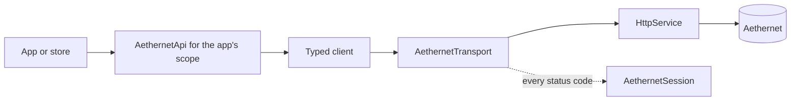
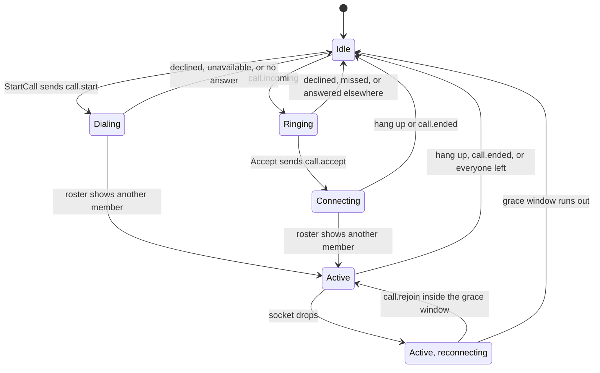

# Networking

This page explains how the plugin talks to Aethernet, its online service: how a request is made, how failures reach your code, sessions and sign-in, the live connection, calls, end-to-end encryption, uploads, and how to point a build at a test server. Read it before you write a feature that needs the server. The server is a separate, private project, so this page describes only what the plugin sends and how it reacts to each answer.

## Key files

| Path | What it is |
| --- | --- |
| src/Aetherphone/Core/Net/HttpService.cs | The shared HTTP client: JSON calls, rate-limit pauses, ETag cache, downloads |
| src/Aetherphone/Core/Net/AepFailure.cs | The failure value typed clients report instead of throwing |
| src/Aetherphone/Core/Localization/FailureText.cs | Turns a failure into localized UI text |
| src/Aetherphone/Core/Aethernet/AethernetTransport.cs | Adds the base URL and token; skips calls while signed out |
| src/Aetherphone/Core/Aethernet/Clients/ | One typed client per server area; wire records live in Contracts/ beside it |
| src/Aetherphone/Core/Aethernet/AethernetJsonContext.cs | Source-generated JSON metadata for every wire record |
| src/Aetherphone/Core/Aethernet/AethernetSession.cs | Signed-in state, token, per-character slots |
| src/Aetherphone/Core/Aethernet/SignInFlow.cs | The three sign-in flows |
| src/Aetherphone/Core/Telephony/RealtimeConnection.cs | The websocket |
| src/Aetherphone/Core/RealtimeSignalBus.cs | In-process events fed by the websocket |
| src/Aetherphone/Core/Telephony/CallHub.cs | The voice call state machine |
| src/Aetherphone/Core/Crypto/ | End-to-end encryption |

## What Aethernet is

Aethernet is the service behind every shared feature: accounts, chats, feeds, calls, uploaded media, online games, and the casino. Nothing in this repo builds or runs it. The plugin reaches it two ways: HTTPS requests to a base URL, and one websocket per signed-in session on the same host. Purely local apps (notes, the calculator, most mini-games) never touch the network.

Some apps call public services directly. None of them receive the Aethernet token or headers.

| Service | Used by |
| --- | --- |
| Universalis | Market |
| Faloop | Hunts |
| LRCLIB | Lyrics in Music |
| The Lodestone, through NetStone | Character lookups and portraits |
| lodestonenews.com | News |
| FFXIV Venues, Partake | Venues |
| radio-browser and the stations | World radio in Music |
| FFXIV Collect, the housing APIs, Rolladeck | Collections, Housing, Music |
| YouTube, through YoutubeExplode | Songs in Music |
| GitHub | Media tool downloads (see [Media and video](media-and-video.md)), Dalamud's plugin list for Shortcuts |
| GitHub and Debian's package archive | Doom game data |

Most ride `HttpService`; services that ask for polite pacing also go through `RequestThrottle` (src/Aetherphone/Core/Net/RequestThrottle.cs).

## The request path



An app never builds an Aethernet URL or its own `HttpClient`. Each app that talks to Aethernet gets an `AethernetApi` made for its app scope (a short id such as `"announcements"`) from AppRegistry (src/Aetherphone/Core/Apps/AppRegistry.cs). The scope travels as the `X-Aep-App` header and tells the server which of the account's per-app profiles to answer with.

`AethernetApi` exposes one typed client per area (`Announcements`, `Chats`, `Media`, `Keys`, and so on). `AethernetTransport` prefixes the base URL, attaches the token, returns `null` at once while signed out, and reports every status code to `AethernetSession`. `HttpService` owns the pooled `HttpClient` and serializes through `AethernetJsonContext` (camelCase, no reflection). Headers meant for Aethernet, such as `X-Aep-App` and a fresh `X-Aep-Request-Id`, go only to the base URL's host. GET answers with an `ETag` are cached, and a `304 Not Modified` is served from the cache.

A typed client method, from src/Aetherphone/Core/Aethernet/Clients/AnnouncementsClient.cs:

```csharp
public Task<AnnouncementPage?> ListAsync(string? cursor, CancellationToken token,
    Action<AepFailure>? onFailure = null)
{
    var path = "/announcements";
    if (cursor is not null)
    {
        path += $"?cursor={Uri.EscapeDataString(cursor)}";
    }

    return net.GetAsync(path, AethernetJsonContext.Default.AnnouncementPage, token, null, onFailure);
}
```

## Errors without exceptions

Typed clients never throw on an HTTP failure. They return `null` (or `false`), and the optional `onFailure` callback says why. An `AepFailure` has a kind: offline, timeout, rate-limit pause, signed out, server error, unreadable response, or cancelled. A server error also carries the status, the error body's `Code`, and the request id. `AepFailure.Describe()` formats all of it for the log; quote the request id in a bug report.

`FailureText.Resolve` maps a failure to localized copy, one string per known server code. Draw code keeps a `FailureSlot`, which caches that text until the failure or the language changes.

Worked example: the Announcements store runs the call on a worker task and keeps the failure (src/Aetherphone/Apps/Announcements/AnnouncementsStore.cs):

```csharp
var reported = AepFailure.None;
var page = await client.ListAsync(null, token, failure => reported = failure).ConfigureAwait(false);
if (page is null)
{
    failureBox = new AepFailureBox(reported.Failed
        ? reported
        : AepFailure.Transport(AepFailureKind.Offline));
    AepLog.Warning($"Announcements failed to load: {failureBox.Failure.Describe()}");
    return;
}
```

Each frame, the list screen copies the store's failure into its `FailureSlot` and draws a "Couldn't load this" panel with the slot's text and a Retry button that calls `store.Refresh()`.

Three answers need their own handling:

- **Refusals as data.** Sign-in verification, the game rooms, and the casino answer an expected refusal with HTTP 200 and a reason in the body. A `null` from them is always a transport problem, never a rule.
- **An app switched off.** `AppAvailability` reads the server's app flags and hides any app reported as off. A call into such an app fails with 503 and the code `app_disabled`. Show it as temporary, never as a sign-out.
- **Rate limits.** A 429 on a GET pauses every GET to that host until `Retry-After` passes (at most 30 seconds), so unrelated features can look broken meanwhile; the `RateLimitPill` under the status bar counts down. A 429 on a write fails only that call. A 429 without `Retry-After` pauses nothing, and a GET is retried once.

## Adding an endpoint

The server half lives in the private repository, so agree on the route and record shapes with its maintainers first. Then:

1. **Records.** Add the request and response records under src/Aetherphone/Core/Aethernet/Contracts/. Default every field the server might leave out.
2. **Registration.** Add `[JsonSerializable(typeof(YourRecord))]` to `AethernetJsonContext` for each top-level record. `AethernetJsonContext.Default.YourRecord` exists only after that.
3. **Client method.** Add a method to the area's typed client, shaped like the sample: route, records, a `CancellationToken`, and `onFailure` passed through. Escape path segments with `Uri.EscapeDataString`.
4. **Store.** Call it from a store on a worker task, never from `Draw`, and publish the result in a field the draw code reads.
5. **Failure.** Keep the `AepFailure`, log `Describe()`, and show the localized text with a retry. A new server code needs a constant in `FailureCodes` and a case in `FailureText` (both in src/Aetherphone/Core/Localization/FailureText.cs), plus a string in L.cs and all nine locale files (see [Localization](localization.md)).
6. **Test.** Add a test in src/Aetherphone.Tests that parses a server-shaped JSON string through `AethernetJsonContext`, like the `*WireContractTests.cs` files, including a body without the new fields.
7. **Staging.** If the client may ship first, gate the feature on what the server reports (an app flag or a feature list), never on the client version.

## Sessions and sign-in

`AethernetSession` holds the signed-in state, and the token is saved in the plugin configuration. A player can own several characters, so the session keeps one slot per character, keyed by ContentId (the game's stable character id); switching characters swaps the token and key cache.

The server can stop accepting a token at any time. The first 401 marks it rejected, `IsSignedIn` turns false, later requests skip the network, and the player signs in again from Settings > Account.

Sign-in proves the player owns the character. `SignInFlow` runs three flows:

- **Lodestone.** The client sends the character's name and world and gets a short code. The player pastes it into their Lodestone profile, then verify returns a token and the user record.
- **Rising Stones.** The Chinese game version has no Lodestone, so the client sends the player's Rising Stones UID instead, and the code goes into their Rising Stones signature. Verification is shared.
- **XIVAuth.** The client starts a device flow, opens the approval page in the browser, and polls until the player approves, cancels, or it times out.

Verify answers expected failures in the body. The reason strings are mirrored in `VerifyFailure` (src/Aetherphone/Core/Aethernet/VerifyResult.cs), and `SignInFailureText.Resolve` turns each into a localized title and message. A `banned` reason calls `AethernetSession.ReportBanned`, which puts up the ban screen.

## The live connection

`RealtimeConnection` keeps one websocket open at the base URL's host, path `/rt`, with the token in the `Authorization` header. Text frames are JSON control messages; binary frames are call audio. It lives in Core/Telephony but carries every live push, and it runs whenever a session is signed in. `CallSignalRouter` routes most messages by type; watch-along and Jam messages go to their own routers (`StreamSignalRouter`, `JamSignalRouter`) on the same connection:

| Messages | Handled by |
| --- | --- |
| `call.*` | `CallHub` (see [Calls](#calls)) |
| Pings such as `chat.ping`, `social.ping`, `keys.stale`, `content.removed` | Events on `RealtimeSignalBus`; stores refresh what the ping names |
| `casino.*`, `game.*` | The casino stores and `GameRoomsStore` (see [Casino](casino.md), [Games framework](games-framework.md)) |
| `radio.*`, `jam.*`, `stream.*` | Community Radio, Jam, and watch-along parties (see [Media and video](media-and-video.md)) |

To send upstream, a store calls `RealtimeSignalBus.TrySend`, which returns false while the socket is down.

The connection reconnects until stopped, with a growing random delay. When it returns, stores call `PollCadence.RequestAfterReconnect`, which schedules a catch-up poll at a random moment within 20 seconds, so nothing missed stays missed and clients do not all return at once.

Polling is the backstop. Each store polls on a `PollCadence` (src/Aetherphone/Core/Runtime/PollCadence.cs), faster while the phone is visible, and stretched to a slow safety poll while the socket is up unless the surface is on screen and calls `NoteWatched`. Even with a dead socket, messages and notifications arrive within a couple of minutes.

## Calls

Calls ride the same websocket: signaling as `call.*` messages, audio as binary frames the server relays to the others in the call. There is no peer-to-peer connection.



`CallHub` owns the state, and every teardown returns straight to `Idle` (it never rests in `Ended`). An incoming call is declined at once as unavailable when calls are off or ChocoChat (the Message app) is not installed, and as busy during another call. The server's roster is the only truth about who is in a call. After a socket drop the hub keeps the call for a short grace window: if the socket returns in time it sends `call.rejoin` (and repeats `call.accept` if it was still connecting), otherwise the call ends. A call that is still ringing when the socket drops is logged as missed instead.

Audio goes out through `AudioCapture` (microphone, automatic gain capped at -3 dBFS or the manual volume, and a noise gate that opens at the player's mic threshold, set on the same scale as the input meter in `MicThreshold`), `OpusAudio` (the managed Concentus codec), and `MediaFrame` (call id, slot, sequence). Mute stops encoding, so nothing is sent. Coming in, `VoiceMixer` keeps a decoder and jitter buffer per person, applies per-person volume, mixes, and plays.

`CallLogStore` keeps the call log. Missed calls also arrive later as social notifications, and `CallLogStore` skips one that echoes a miss it logged moments before. ChocoChat owns the call screens, and every surface reads `CallHub.Snapshot()`, an immutable `CallView`, each frame.

## End-to-end encryption

Direct conversations (ChocoChat chats, Velvet DMs, Aethergram DMs) are encrypted on the PC once every member has published a key, and the server then stores only ciphertext. Until then a conversation is plaintext and labeled Not encrypted. Yellow Pages inquiries are always sealed: their composer stays blocked until it can encrypt. Once a conversation is encrypted, a plaintext send is refused with 409 `thread_encrypted`, so `EncryptedSendPolicy` holds a send until the key status is known. Attachments and voice notes use the same key. Posts, comments, and profiles are public.

Three prefixes mark encrypted data on the wire:

- `EC1.` is a conversation key sealed to one member's public key; each member gets their own copy.
- `AE1.` is a message body, stamped with its key generation and bound to the conversation and sender. Its commitment tag lets a report prove what the message said.
- `EL1.` is an identity key sealed for transfer between two of the account's PCs.

The primitives are P-256 key agreement (ECDH: two key pairs derive one shared secret) and AES-GCM (authenticated encryption). The curve math runs in BouncyCastle because some Wine setups lack P-256 in the system provider.

How a key lives and comes back (`KeyVault`, `ConversationKeyStore`):

- **On the PC.** The private key stays in the plugin configuration, sealed with Windows DPAPI. If DPAPI fails, it is stored unsealed and Settings > Encryption warns.
- **Recovery code.** A code the player keeps seals a copy the server stores but cannot open. Entering it on a new PC restores the same key and all history.
- **Another PC.** A new PC can ask one that holds the key to send it; the player approves there after comparing a code shown on both.
- **Other members.** After a key change the server pushes `keys.stale`, and members who hold the conversation key seal a fresh copy for the new key.

What the server can still see:

- Who is in each conversation, when each message is sent, its size, and whether it is text, an image, or a voice note.
- Reactions, read receipts, and typing signals.
- Every conversation that is not encrypted yet.
- Text the player translates: the plugin decrypts it and sends it to Aethernet, after a one-time disclosure.
- A report: the reported message and the few before it, decrypted, after the report sheet's disclosure.

## Uploading media

An upload is three steps, all visible in src/Aetherphone/Core/Aethernet/AvatarUpload.cs:

1. `MediaClient.UploadUrlAsync` sends the content type and a scope (such as `"avatar"`) and gets back a key, an upload URL, and a public URL.
2. `MediaClient.UploadImageAsync` PUTs the bytes. The token goes along only when the upload URL is on the API host.
3. A follow-up call uses the result, such as a profile update with the public URL or a chat send with the key.

In an encrypted conversation, `MessageCipher.PrepareOutboundMedia` seals the bytes before step 2. A refused upload comes back with a `media_*` code that `FailureText` maps. Image baking before upload is covered in [Assets and media](assets-and-media.md), and the download caches in [State and persistence](state-and-persistence.md).

## Pointing a build at another server

The base URL is `Configuration.AethernetBaseUrl`. A Release build defaults to the live server; Debug and Beta builds default to `Configuration.TestAethernetBaseUrl`, the development server, which keeps its own accounts, so sign in there with the usual flows. Debug and Beta builds also show a Test server switch in Settings > About, which changes the URL and signs you out.

A local backend needs access to the private server repository. With the plugin unloaded, set `AethernetBaseUrl` in its config file (`AetherphoneDev.json` for Debug, `AetherphoneBeta.json` for Beta; [State and persistence](state-and-persistence.md) says where it lives). At boot, `Configuration.NormalizeAethernetBaseUrl` resets invalid URLs, and a Release build also resets loopback URLs, so if your local URL keeps disappearing you are on a Release build.

Without a server, local apps work and server apps show their signed-out state. Never test unreleased client changes against the live server, and keep tokens out of commits, shared logs, and screenshots.

## Gotchas

- "The API stopped responding" is often one 401 that signed the whole session out. Check `AethernetSession.TokenRejected` first.
- Do not stop the socket when calls are turned off. Pings and every live room ride on it.
- Add any new Aethernet header where `HttpService` adds `X-Aep-App`, behind the same host check, so third-party hosts never see it.
- A running plugin rewrites its whole config file on every save, so a hand edit made while it is loaded is lost.
- Resolve failure text at draw time (`FailureSlot.Text()`), never when the failure is captured, or it stays in the previous language.
- `EtagCache` keys include the token and scope on purpose. Two scoped clients asking for the same URL keep separate entries; do not merge them.

## Related docs

- [Getting started](getting-started.md): build and load a Debug or Beta build
- [Architecture](architecture.md): where `PhoneServices` wires these services
- [App framework](app-framework.md): how an app gets its scoped `AethernetApi`
- [Messaging and chat](messaging-and-chat.md): the chat stores built on these clients
- [Notifications](notifications.md): how pings and polls become banners and badges
- [Media and video](media-and-video.md): watch-along parties, Jam, Community Radio, media tools
- [State and persistence](state-and-persistence.md): the config file and media caches
