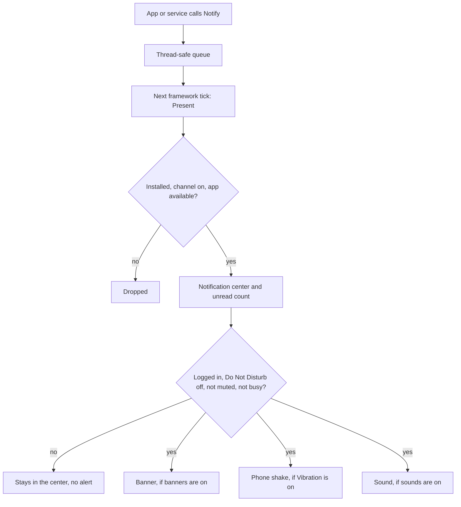

# Notifications

This doc follows a notification through the client: how an app posts it, which settings and game states hold it back, how the notification center and banners show it, what sound it plays, and how a tap lands the player on the right screen. Read it before you make an app post notifications, add a deep link, or add a badge, and when a banner or badge misbehaves.

## Key files

| Path | Why you open it |
| --- | --- |
| src/Aetherphone/Core/Notifications/PhoneNotification.cs | The record every producer creates |
| src/Aetherphone/Core/Notifications/NotificationService.cs | The queue, the filters, the shared alert gates, the unread count |
| src/Aetherphone/Core/Notifications/NotificationChannels.cs | The catalog of per-app settings channels |
| src/Aetherphone/Core/Notifications/NotificationRouter.cs | Turns a tap into navigation; one branch per deep link |
| src/Aetherphone/Core/Apps/LaunchIntent.cs | Holds one pending deep link until the app takes it; most launchers wrap it |
| src/Aetherphone/Core/Apps/NavigationStack.cs | Re-runs an app's open hook, the contract deep links depend on |
| src/Aetherphone/Core/Notifications/SocialNotificationService.cs | Social activity from the server, social badges, read acknowledgements |
| src/Aetherphone/Core/Moderation/ModerationNoticePresenter.cs | Shows moderation notices as notifications and alerts |
| src/Aetherphone/Windows/Components/Notify/NotificationDeck.cs | The stack, swipe, and tap engine behind both notification lists |
| src/Aetherphone/Apps/Settings/Pages/AppSettingsPage.cs | One app's Allow Notifications, Banners, Sounds, and Badges switches |

## The pipeline

Every notification takes the same path, whoever produced it:



1. `NotificationService.Notify` only enqueues, so any thread may call it.
2. The next framework tick (the game's main thread, once per frame) drains the queue.
3. A notification is dropped when its app is not installed, its channel is off, or the server has switched its app off.
4. A survivor joins the newest 50 in the center and raises the unread count. Nothing expires by age.
5. Alerts pass four shared gates: logged in, Do Not Disturb off, no timed mute, and, when Quiet While Busy is on, not busy (combat, a duty, a cutscene, or zoning).
6. Banner, shake, and sound then each check their own switches, so turning banners off does not stop the shake or the sound.

## Posting a notification

`PhoneNotification` is a record. A local producer sets the first six fields; the rest are for social items and special cases:

| Field | Meaning |
| --- | --- |
| `AppId` | The app the notification belongs to and opens |
| `Title`, `Body` | Card and banner text |
| `ReceivedAt` | The time shown on the card |
| `Accent` | Tile color, normally `AppAccents.For(appId)` |
| `GroupKey` | Optional stacking key: one conversation, one post, one category |
| `ChannelId` | Optional settings channel that replaces `AppId` for the settings lookup |
| `Muted` | Skips the notification sound only, for producers that ring some other way |
| `ActorId`, `PostId`, `SocialType`, `CreatedAtUnix` | Deep link targets and read-acknowledgement data for social notifications |

Two derived keys drive everything else. `StackKey` is the app id joined to the group key when one is set (`velvet:user-1`), otherwise the app id alone, so two apps that key on the same user never share a stack: the center stacks by it, a banner replaces by it, the sound throttle (one sound per stack every 3 seconds) keys on it, and `NotificationService.RemoveGroup(appId, groupKey)` clears it. `SettingsKey` is the channel id when set, otherwise the app id, and every per-app setting except the timed mute is looked up by it.

`TimerNotifier` (src/Aetherphone/Core/Notifications/TimerNotifier.cs) is a small producer. It passes one group key per category, so resets, ventures, and voyages each stack on their own:

```csharp
private void Notify(string title, string body, string group)
{
    notifications.Notify(new PhoneNotification(AppId, title, body, DateTime.Now, Accent, group));
}
```

Get `NotificationService` through constructor injection like any other service (see [Architecture](architecture.md)). Resolve the title and body with `Loc.T` when you post: the card keeps that text, even after a language switch.

### Posting from a new app

1. Choose a group key for each stream the app can produce (a conversation, a post, a category). Without one, everything stacks into one card.
2. Add a settings channel so players can control the app's alerts (next section).
3. Post with `Notify` from wherever the event happens; the call is thread safe.
4. For a home screen badge, return the count from `BadgeCount` and set `HasBadge` to true so Settings shows a Badges switch.
5. For a deep link, add a launcher, a router branch, and consumption in `OnOpened` and `OnResumed` (see [Deep links](#deep-links-what-happens-on-tap)).
6. Load the Debug build and check the banner, the center card, the tap target, and the app's row under Settings > Notifications and Badges.

### Adding a channel

A channel is one entry in `NotificationChannels.All`: an app id, a localized name, and an accent. Every app already has a name in `L.Apps`, so an entry is one line, like the Fishing one:

```csharp
new("fishing", L.Apps.Fishing, AppAccents.For("fishing")),
```

The entry gives the app a row on Settings > Notifications and Badges and the Allow Notifications, Banners, Sounds, and sound picker controls on its settings page. Without a channel the app still posts, but the player cannot turn its alerts off. Settings live in `Configuration.NotificationSettings`, keyed by `SettingsKey`, and a missing entry means every switch is on. One channel is not in the list: call notifications post under the ChocoChat app id with `ChannelId = NotificationChannels.PhoneChannel`, so they resolve under `phone` and no Settings row toggles them.

## The notification center and banners

Two hosts draw the notification list with one engine, `NotificationDeck`: the panel in the pull-down Control Center, and the Notifications app with its day sections, per-app filter chips, and mute card. Both group by `StackKey`, newest first, and rebuild groups only when the list or the language changes, never per frame.

A collapsed stack shows its newest card with layers behind it, and a tap expands it. Swiping left reveals Clear, a long swipe or a right-click clears at once, and on a collapsed stack the swipe clears the whole group. Clearing a social notification acknowledges it on the server up to that item.

`NotificationBanner` (src/Aetherphone/Windows/Components/Notify/) listens for the `Presented` event and drops a card from the top of the screen, except while the phone is hidden or the notification's own app is on screen. A newer item in the same stack replaces the showing banner in place. A tap opens it and an upward drag dismisses it. The minimized phone shows its own small alert card under the same rules.

Clock alarms and the Clock app's timer post a notification marked `Muted` and ring through `AlarmRinger` instead, even in Silent Mode. The ringer brings the phone forward like an incoming call and stops after five minutes.

## Settings and gates

Everything that holds a notification back, in pipeline order:

| Gate | Effect |
| --- | --- |
| App not installed, channel off, or app switched off by the server | Dropped before the center |
| Logged out, Do Not Disturb, timed mute, or Quiet While Busy | In the center and counted as unread, but no banner, shake, or sound |
| Banners off, globally or for the channel | No banner; shake and sound still happen |
| Sounds off for the channel, Notification Sound off, or Silent Mode | No sound; banner and shake still happen |
| Same stack sounded in the last 3 seconds | Sound skipped |
| Phone hidden, or the app already on screen | No banner; the center still gets it |
| Chat gates: a muted channel or conversation, the thread on screen | No notification; see [Messaging and chat](messaging-and-chat.md) and [Linkpearl](linkpearl.md) |

Quiet While Busy is on by default, so out of the box, alerts are silent in combat, duties, cutscenes, and zoning, while the notification still lands in the center. Players often report this as a bug; the switch is on Settings > Notifications and Badges. The timed mute (Mute 1 Hour, Mute Today, Unmute) comes from the per-app card in the Notifications app.

Do Not Disturb has one setting, `Configuration.DoNotDisturb`, and many switches: the Action key on the phone, the switch on the main Settings page, the Control Center tile, the moon button and Turn Off pill in the Notifications app, the Quick Toggles widget, the Spotlight action, and the `/phone dnd` chat command (`/phonedev dnd` on Debug builds). While it is on, a moon shows in the status bar and the coin earn pill holds its toasts.

## Sounds

There are two sound kinds, ringtones for calls and notification sounds for everything else, each with a library of bundled and player-added files. A setting stores a token, never a path: `file:` plus a file name, `silent`, or empty for the library default, and a token whose file is gone falls back to the default. Each channel can override the global notification sound.

`SoundService` adds its own switches on top of the pipeline gates. Silent Mode stops notification sounds, ringtones, and the outgoing call ringback; alarm and timer tones ignore it. The Notification Sound and Ringtone switches on Settings > Sounds turn off their kind entirely.

Interface sounds (taps, toggles, keyboard clicks, transitions, game cues) are a separate system. Code fires a cue with `UiFeedback.Play(UiSound.Tap)` or another `UiSound` value, and it plays only when Silent Mode is off, the Interface Sounds master switch is on, and its group's switch is on. A fresh install starts with interface sounds on; installs that predate the setting start with them off. Sound files and cues are in [Assets and media](assets-and-media.md).

## Deep links: what happens on tap

Tapping a card or banner calls `NotificationRouter.Open`, which:

1. Acknowledges a social notification on the server up to that item.
2. Removes the whole stack from the center, and stops there if the app is unavailable.
3. Parks the destination in the app's launcher, from the notification's `GroupKey`, `PostId`, or `ActorId`. The if-chain in `Open` is the source of truth for which apps deep link.
4. Opens the app.

The contract that makes this land: **opening an app always runs its open hook, even when the app is already on screen.** `NavigationStack.OpenApp` runs `OnOpened`, unless the app implements `IResumableApp` and was closed less than ten minutes ago, in which case it runs `OnResumed` and the app keeps its screen. Going Back onto a resumable app also runs `OnResumed`.

To support deep links in your app:

- A launcher that stores one pending request and hands it out once. `MusterLauncher` (src/Aetherphone/Core/Muster/MusterLauncher.cs) wraps a `LaunchIntent` in three lines. Register yours in `PhoneServices` and hand it to your app and to the router, which src/Aetherphone/Core/Shell/PhoneShell.cs builds.
- A branch in `NotificationRouter.Open` that fills the launcher.
- Consumption in `OnOpened` after resetting navigation, and in `OnResumed` if the app is resumable.

`MessageApp` (src/Aetherphone/Apps/Message/MessageApp.cs) shows the shape, abridged here: both hooks end in one consumer.

```csharp
public void OnOpened()
{
    router.Reset();
    activeTab = MessageTab.Chats;
    RefreshAndConsumeLaunch(forceContacts: true);
}

public void OnResumed()
{
    RefreshAndConsumeLaunch(forceContacts: false);
}

private void ConsumeLaunchRequests()
{
    if (launcher.TryConsumeCalls())
    {
        activeTab = MessageTab.Calls;
        return;
    }

    if (launcher.TryConsumeConversation(out var conversationId))
    {
        ShowLaunchedThread(conversationId);
    }
}
```

Because the hooks re-run, keep them cheap and safe to repeat: `OnOpened` resets first and then consumes, and `OnResumed` navigates only when the launcher holds something. A consume-once launcher means a plain open from the home screen never replays the last deep link.

## Badges

A home screen badge is `IPhoneApp.BadgeCount`, computed by each app; the notification center does not drive it. `BadgeAsDot` draws a dot instead of a number. Setting `HasBadge` to true gives the app a Badges switch in Settings, and the home screen checks that switch before drawing, so your `BadgeCount` never needs to.

The Notifications app's badge, the unread count, also shows in two more places, and turning that badge off clears all three:

- The minimized phone shows the count on its puck.
- The server info bar entry (`ServerBarEntry`) in the game's top bar shows the game's Aethernet icon (with a Dev or Beta tag on those builds), then the unread count. Settings > General picks one of three styles: icon only (the default, the same as before the setting existed), icon and text, or text only, and the text is a label the player can edit (default "Aetherphone"). Its tooltip names the plugin and the unread count, and clicking it toggles the phone.

Neither recomputes per frame; both refresh on change events. A social app's badge prefers the server's unread counts from the last poll, and opening its activity screen clears the count and sends a read acknowledgement. Acknowledgements are saved and retried until the server confirms them, so they survive a flaky network and a restart.

## Social and moderation notifications

Social activity (likes, comments, follows, mentions, missed calls, and more) arrives from the server as numbered types, cataloged in `SocialActivity` (src/Aetherphone/Core/Social/SocialActivity.cs). The numbers are a wire contract, duplicated as private constants in `NotificationRouter`. To add a type, change both in lockstep with the server: the constant and card text in `SocialActivity`, and the tap target in `NotificationRouter.SocialLinkFor`.

Moderation notices never show as social activity: the social feed skips the moderation types, and moderation notices arrive on their own. `ModerationNoticePresenter` posts each pending notice once, as a Settings notification that opens the Safety page on tap. A non-blocking notice is acknowledged at once; a blocking one also opens an alert and is acknowledged when the player dismisses it. `ModerationNoticeText.IsBlocking` decides which kinds block:

- Blocking: content removed, a warning, a profile picture removed, profile text cleared, a suspension, a moderator sign-out, a name reset, a frozen Aether Coin wallet, and any kind this build does not recognize.
- Not blocking: a report outcome, a badge or frame granted or removed, an Aether Coin balance change, a post marked sensitive, and an unfrozen wallet.

`ModerationNoticeText` also builds the notice copy from L.cs strings, and notices that touch the wallet refresh the coin balance at once.

## What persists

The notification center lives in memory only: a plugin reload or game restart starts empty with no unread count, and uninstalling an app removes its notifications. What survives lives in `Configuration`: the channel settings and timed mutes, the badge switches, the per-account social seen markers, and read acknowledgements the server has not confirmed yet. See [State and persistence](state-and-persistence.md).

## Gotchas

- `Notify` only enqueues. Do not look for the notification in the recent list right after the call.
- Heavy work or a scroll reset in `OnOpened` repeats on every deep link, because the hook re-runs. A resumable app that consumes only in `OnOpened` leaves the deep link waiting until a later full open.
- The timed mute is keyed by `AppId`, unlike every other setting. Muting ChocoChat from the Notifications app also silences call notifications.
- Do not "fix" a call notification by editing the ChocoChat channel; calls resolve under `phone`.
- Opening the Notifications app or the Control Center marks everything read and acknowledges every social app, so a badge does not survive a peek at the pull-down.
- The banner queue is short. A burst lands in the center, but most of it never shows a banner.
- A new social type added only to `SocialActivity` renders but routes nowhere: the tap opens the app's root.
- The Vibration setting vibrates nothing: it shakes the minimized phone and the open phone, and fires even with banners off.

## Related docs

- [App framework](app-framework.md): the `IPhoneApp` contract, badges, and navigation
- [Creating an app](creating-an-app.md): the tutorial, including a first notification
- [Messaging and chat](messaging-and-chat.md): the chat stores and their notification rules
- [Networking](networking.md): the realtime pings and polling behind social notifications
- [Assets and media](assets-and-media.md): sound files and interface sound cues
- [State and persistence](state-and-persistence.md): where the notification settings are saved
