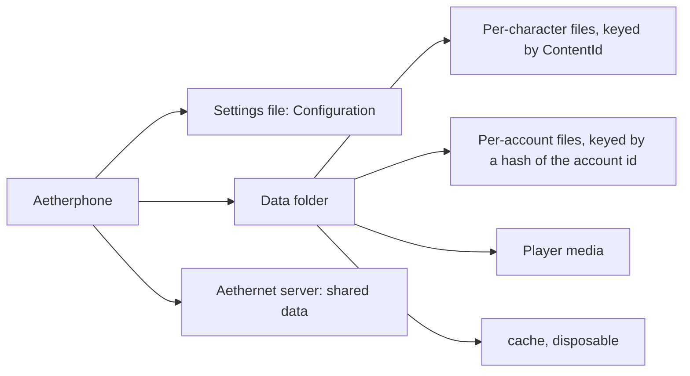

# State and persistence

This doc explains where Aetherphone keeps data on the player's PC: the one settings file, the files kept per character and per account, the media the player creates, and the caches. Read it before you add any new piece of state, so you know whether it belongs in the settings object, in its own file, or on the server. Read the reset section when you need a clean phone for testing or support. Everything here is client side; how the client talks to the server is in [Networking](networking.md).

## Key files

| Path | Why you open it |
| --- | --- |
| src/Aetherphone/Configuration.cs | The settings object and its one-shot migration methods |
| src/Aetherphone/Core/Config/ConfigMigrations.cs | Type-name rewrites that run on the raw JSON before it loads |
| src/Aetherphone/Plugin.cs | Boot order: the type-name rewrite, the load, then every migration call in order |
| src/Aetherphone/Core/PhoneServices.cs | Builds most stores and picks their folders |
| src/Aetherphone/Core/Game/CharacterWatch.cs | Raises an event when the logged-in character changes |
| src/Aetherphone/Core/Aethernet/AethernetSession.cs | The active account and the per-character session snapshots |
| src/Aetherphone/Core/GameChat/ChatArchive.cs | The reference store for per-character files |
| src/Aetherphone/Core/Net/DiskCache.cs | Size-capped disk cache for downloaded bytes |
| src/Aetherphone.Tests/ConfigMigrationsTests.cs | Migration tests; the other config tests sit beside it |

## Where data lives

Dalamud (the plugin framework that hosts Aetherphone inside FFXIV) gives each plugin one settings file and one private data folder. The settings file is the serialized `Configuration` object. The data folder holds everything too large or too fast-growing for that file.



| Kind of data | Where it lives | Examples |
| --- | --- | --- |
| Small settings and short lists | The settings file | Toggles, volumes, notes, alarms |
| Small per-character values | Dictionaries in the settings file, keyed by ContentId | Custom job categories |
| Growing per-character data | A subfolder per feature, one file or folder per character | GameChat, Activity, Health, Wallet |
| Sign-in and encryption keys | The settings file, one entry per character or account | Session tokens, end-to-end private keys |
| Per-account files | History and Velvet, one file per account | Messages this PC already decrypted |
| Player media | Photos, Sounds, Wallpapers, ShortcutIcons, Music | Camera shots, custom ringtones, offline songs |
| On-demand downloads | doom, aetherstream | Files fetched on first use |
| Caches | cache | Images, media, audio, lyrics; cache/inventory is the exception, holding per-character inventory snapshots |
| Data shared with other players | The server | Profiles, posts, chat threads, uploaded media |

Bundled read-only assets ship beside the plugin DLL and are never overwritten; see [Assets and media](assets-and-media.md). A ContentId is the game's stable 64-bit id for one character: it survives renames and world transfers, which is why per-character data keys on it.

## Where the files are on disk

Dalamud names the settings file and the data folder after the plugin's internal name. Each build variant has its own internal name, so the three builds are separate plugins that never share data:

| Build | Settings file | Data folder |
| --- | --- | --- |
| Release (stable) | pluginConfigs/Aetherphone.json | pluginConfigs/Aetherphone/ |
| Debug (dev plugin) | pluginConfigs/AetherphoneDev.json | pluginConfigs/AetherphoneDev/ |
| Beta | pluginConfigs/AetherphoneBeta.json | pluginConfigs/AetherphoneBeta/ |

The pluginConfigs folder sits in the XIVLauncher data folder, normally %AppData%\XIVLauncher on Windows; Linux and macOS launchers keep it in their own data directory. In code the paths are `PluginInterface.ConfigFile` and `PluginInterface.ConfigDirectory`. The running plugin rewrites the whole settings file on every save, so edit it by hand only while the plugin is unloaded, or the next save overwrites your edit.

## Resetting data

Players can reset parts of the phone from inside it:

- Settings > Privacy > Clear cached images and media empties the caches. Everything downloads again the next time it is shown.
- Some apps reset their own data: Health has Reset all Health data (for the current character), Linkpearl has Clear history per conversation, and Settings > Tips & Tutorials replays the guides.
- Settings > Account > Delete account erases the account on the server, then clears this PC's caches and readable chat history and signs out.

A full local reset, for testers, support, and developers:

1. Unload the plugin in Dalamud's plugin installer, or close the game.
2. Delete the settings file and the data folder for that build (see the table above), plus the settings file's .pre-migration.bak twin if one exists.
3. Load the plugin again. It boots as a fresh install and runs first-boot setup.

A full reset also deletes this PC's sign-in tokens and encryption keys. The player signs in again, and older encrypted chats come back through a recovery code (Settings > Account > Encrypted Chats), another PC that still holds the key, or the people they chat with, whose phones pass the shared chat keys to the new one. To reset one area instead, delete only its subfolder while the plugin is unloaded: Health removes every character's Health data, and cache removes the caches plus the saved inventory snapshots described under [Media and caches](#media-and-caches).

## The settings object

`Configuration` implements Dalamud's `IPluginConfiguration`: one flat class of booleans, numbers, strings, lists, and dictionaries. The plugin loads it once at boot as the static `Plugin.Cfg`, and services get the same instance through their constructors.

To change a setting, set the property and call `Save()`. Saving always happens on the framework thread (the game's main update thread): called there, `Save()` writes at once; called anywhere else, it queues the write for the next frame and returns. A failed write is logged, never thrown. When a write must land before you continue, `await configuration.SaveNowAsync()` instead.

Keep the object small. The whole file is read at boot and rewritten in full on every save, so anything that grows lives in the data folder instead.

## Schema migrations

There are three tiers of migration, from cheapest to heaviest. Pick the lightest one that works.

**1. Add a property with a default.** A property missing from old JSON gets its initializer, so `public bool ShowAppNames { get; set; } = true;` needs no migration at all. This is the normal case.

**2. One-shot migrations.** When existing data must change once (ids renamed, values moved, a default flipped for upgrading users), add a migration method on `Configuration` and call it from the `Plugin` constructor next to the others. That block in src/Aetherphone/Plugin.cs is the source of truth for which migrations run and in which order. A guard makes each run once per install: usually a bool flag, sometimes a value only the pre-migration state can have. A few idempotent rewrites (retired sound and wallpaper ids) run on every boot and save only when they change something.

Split the method in two. The public `Migrate...` method calls an internal `Apply...` method that does the work and reports whether it changed anything, then saves. `Save()` needs the running Dalamud framework, which tests do not have, so the split lets a test deserialize saved JSON, call `Apply...`, and assert. Verbatim from src/Aetherphone/Configuration.cs:

```csharp
public void MigrateSeasonalThemeOptIn()
{
    if (!ApplySeasonalThemeOptIn())
    {
        return;
    }

    Save();
}

internal bool ApplySeasonalThemeOptIn()
{
    if (SeasonalThemeOptInApplied)
    {
        return false;
    }

    if (SeasonalThemeMode == SeasonalThemeMode.Automatic)
    {
        SeasonalThemeMode = SeasonalThemeMode.Off;
    }

    SeasonalThemeOptInApplied = true;
    return true;
}
```

Never rename or repurpose a property in place: existing installs silently lose or misread the value. Add a new property and carry the value across with a migration. To give a property a new C# name and keep what is saved, pin the saved JSON key with `[JsonProperty]`, the way `LegacyShowWalletBadge` keeps reading "ShowWalletBadge". The `int Version` property exists only because the Dalamud interface requires it; nothing branches on it.

**3. Type-name rewrites.** The saved JSON embeds assembly-qualified .NET type names for the records stored in config lists. Move or rename such a type and saved files name a type that is gone, so its entries fail to load. `ConfigMigrations.Run` rewrites the raw JSON before Dalamud deserializes it, after backing the file up once to a .pre-migration.bak twin. When you move a serialized type, add its previous and new names to the `TypeRenames` table.

**Moving data out of the settings object.** Give the data its own file and import it once. `LibraryStore` is the reference: it owns Music/library.json, imports the playlists from `Configuration` only when that file does not exist yet, and clears the config lists only after the new file is written.

**Tests.** ConfigMigrationsTests covers the type-name table, ConfigurationBadgeMigrationTests shows the deserialize, apply, and assert shape, and EncryptionKeyStoreTests covers the key store migration (all in src/Aetherphone.Tests). Add a test beside them for every new migration.

## Per-character data

`CharacterWatch` reads the logged-in character's ContentId every frame and raises `Changed(ulong)` when it changes; 0 means logged out. Small per-character values go in a dictionary on `Configuration`. Anything that grows gets a file per character in its own subfolder, written through a temp file and `File.Move(temp, path, true)` so a crash cannot truncate it.

A per-character store reacts to a switch in four steps: flush the outgoing character's unsaved changes, drop the in-memory state, treat 0 as logged out, then point at the new character's folder and load. `ChatArchive.OnCharacterChanged` is the shape to copy. Some stores subscribe to `Changed`; others read `CharacterWatch.CurrentContentId` on their own tick. Either works, as long as no data outlives its character.

## Accounts, sessions, and the reset contract

Aethernet accounts are keyed by ContentId too. `Configuration.CharacterSessions` holds one snapshot per character: its sign-in token, a copy of its encryption key cache, and display details. `AethernetSession` keeps the active account in a few flat config fields; on a switch it stashes them into the dictionary, loads the target snapshot (or clears them), and raises `Changed`. A switch follows the played character by default, or the player can pin one account, so the character can change while the account stays.

End-to-end private keys live in `Configuration.EncryptionKeysByUserId`, one blob per account, read and written by `KeyVault`. Each blob is sealed with Windows DPAPI for the current Windows user; where DPAPI is missing, such as under Wine, keys are stored without it. A replaced key is kept so chats sealed to it still open.

**The reset contract.** Any store that caches account-scoped server data must subscribe to `AethernetSession.Changed`, compare `session.CurrentUser?.Id` with the id it remembered, and clear every cached list, cursor, and id when they differ. `SocialFeedStore` and `ChatThreadStoreBase` (src/Aetherphone/Core/Social/ and src/Aetherphone/Core/Message/) are the reference implementations. Skip it and switching alts shows the previous account's data.

Pick the right trigger. `CharacterWatch.Changed` fires on character switches and suits local, offline data. `AethernetSession.Changed` fires on account switches, sign-in, and sign-out, and suits server data.

## Media and caches

Each kind of player media has one owner. The photo library is the Photos folder, with hidden subfolders for thumbnails, Recently Deleted (purged after 30 days), and pasted images. Custom sounds go to Sounds/Ringtones and Sounds/Notifications, and settings store a token naming the file, never a path. An imported wallpaper is a file in Wallpapers plus a small record in `Configuration`; deleting it removes both.

Everything in the cache folder is disposable except cache/inventory. `DiskCache` keeps each cache under its size budget by deleting the oldest files, so a file can vanish at any time; never keep the only copy of anything there. The image and media caches are sealed with DPAPI for the current Windows user. cache/inventory holds each character's last retainer and saddlebag snapshots, which come back only when the player opens those inventories again, so Clear cached images and media leaves it alone.

Messages this PC already decrypted are the one piece of server data kept locally on purpose. Every chat store hands each successful decrypt to `DecryptedHistoryStore` and falls back to it when a body fails to decrypt (its key is missing, or pending after a key reset), so chats the player has read stay readable. It keeps one sealed file per account in the History folder.

## Rules of thumb for app authors

- New small setting or favorite list: a property with a sensible default, then `Save()` after each change. No migration needed.
- New small per-character setting: a dictionary on `Configuration` keyed by ContentId.
- Growing per-character data: a JSON file per ContentId in a new subfolder, following `ChatArchive` or `ActivityStore`.
- Media the player created: a subfolder with a stable naming scheme, plus a small record list in `Configuration` if it needs settings, like wallpapers.
- Downloaded bytes you can fetch again: a `DiskCache` under the cache folder.
- Shared or account-scoped data: it belongs on the server. Keep it in memory and obey the reset contract. If a slice must survive a restart, give it a file per account named by a SHA-256 of the account id, following `DecryptedHistoryStore`.
- Migrate, never rename in place.

## Gotchas

- Moving a serialized record type stored in `Configuration` to another namespace silently drops players' data unless you add a `TypeRenames` pair. Every entry in that table is a scar from a real move.
- `Save()` called off the framework thread returns before the file is written.
- File names use the ContentId in hex, but the casing differs between stores, and the account-scoped files hash the id differently too. Copy the exact store you follow.
- The photo file name (AEP_ plus the capture time) is load-bearing: the Photos app parses the taken date from it, and place data is keyed by file name. Renaming files in the Photos folder breaks date grouping and loses places.
- `ChatThreadStoreBase` ignores a sign-out (a null account id) and clears only when a different account signs in; `SocialFeedStore` clears on sign-out too. Know which behavior you copy.
- `Configuration.ArchiveTellsToDisk` decides whether any game chat history reaches disk, not only tells. With it off, every channel stays in memory.

## Related docs

- [Architecture](architecture.md): plugin boot order and the frame loop that `Save()` defers to
- [Game integration](game-integration.md): the framework thread and reading the character's ContentId
- [Networking](networking.md): sign-in, sessions, and end-to-end encryption
- [Messaging and chat](messaging-and-chat.md): the chat stores that follow the reset contract
- [Notifications](notifications.md): the notification settings and badge switches stored in config
- [Assets and media](assets-and-media.md): bundled fonts, sounds, wallpapers, and cases
