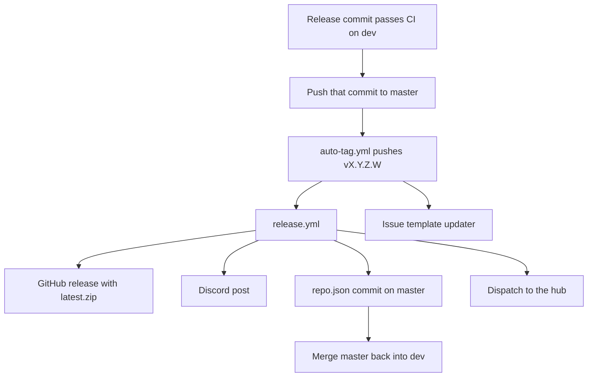

# Testing, CI, and releases

How Aetherphone is checked and shipped: the unit tests, the CI workflow and its guards, the release pipeline, beta builds, the changelog, and the automation a fork inherits. Read the first two sections before your first pull request, and the rest before you cut a release or fork the repository. The Aethernet backend has its own repository and pipeline.

## Key files

| Path | What it is |
| --- | --- |
| src/Aetherphone.Tests/ | The xUnit test project |
| .github/workflows/ci.yml | Guards, Release build, tests, plugin artifact |
| Directory.Build.props | The plugin version; warnings become errors on CI |
| repo.json | This plugin's Dalamud manifest entry |
| .github/workflows/release.yml | Publishes a release from a version tag |
| src/Aetherphone/Core/Changelog/ChangelogData.cs | Every changelog entry, newest first |
| src/Aetherphone/Core/Localization/L.cs | The English changelog bullets |

## Running the tests

Run `dotnet test Aetherphone.sln` from the repository root. To run one class, filter by name:

```
dotnet test Aetherphone.sln --filter "FullyQualifiedName~ChessRulesTests"
```

The test project looks for the Dalamud assembly in the dev-hooks folder of XIVLauncher (Windows), XLCore (Linux) or XIV on Mac, or in the folder named by `DALAMUD_HOME`. Without Dalamud on disk it does not build ([Getting started](getting-started.md) covers installing it). The plugin grants the tests access to its internal types.

### What the suite covers

The suite pins deterministic logic that runs without the game:

- **Encryption and wire formats:** encryption round trips that fail closed on a wrong key or tampered data, recovery keys, and contract tests that pin the JSON the client sends and reads.
- **Mini-games:** a test class per game for rules, scoring and levels, and a same-seed replay test for every seeded board, because the daily challenge must deal everyone the same board.
- **Gamba:** rules, payouts, playback and layouts. Some tests read files under Vectors that are byte-for-byte copies of the server's test vectors, so client and server agree on a rule.
- **Everything else with rules:** the games hub and stage kit, chat and inbox logic, audio decoders (with sample files under Fixtures), game data helpers, config migrations and layout placement.
- **Localization parity:** every key in L.cs exists in all nine catalogs, and no catalog keeps a key L.cs dropped. Nothing checks whether a value is still in English.

There is no rendering test. The phone is drawn with Dear ImGui, which redraws every frame inside the game, so drawing code is checked by loading the plugin in game.

### When to add a test

Add one for anything that touches an encryption or wire format (a silent format change can stop every user from decrypting messages), for every new mini-game board ([Games framework](games-framework.md)), for config migrations, and for any pure service with rules.

Two kinds of test pin values on purpose. TourRegistryTests lists every app tour with its version and step count, so a new or changed tour means updating that table. Most vector tests also pin their file's SHA-256: when the server's vectors change, copy the new file in unchanged and update the hash.

## The CI workflow

.github/workflows/ci.yml runs on pull requests to dev or master and on pushes to either branch. A new push to a pull request cancels its older run; runs on dev and master always finish. The build job waits for the guards.

### Guards

Guards are grep checks that need no compiler, so a mistake fails in seconds. This is the complete list; [Conventions](conventions.md) explains each rule.

| Guard | Fails on | Scope |
| --- | --- | --- |
| Version sync | `<Version>` in Directory.Build.props differing from either version in repo.json | Those two files |
| UI scale seam | Reading `ImGuiHelpers.GlobalScale` outside UiScale.cs | src |
| No em dashes | Any em dash | Every tracked file except announce-commits.yml |
| No async void | Any `async void` | src |
| No new LINQ | `using System.Linq;` outside three allowlisted cold-path files | src/Aetherphone |
| Clock seam | A hand-written "HH:mm" style pattern outside TimeText.cs | src |
| Layering | Core or Windows importing an app, except in AppRegistry.cs and WidgetCatalog.cs | src/Aetherphone/Core, src/Aetherphone/Windows |
| No underscore fields | A private or protected field named with a leading underscore | src/Aetherphone, src/Aetherphone.Tests |
| No byte order mark | A .cs file saved with a UTF-8 BOM | src/Aetherphone, src/Aetherphone.Tests |
| Namespace matches folder | A missing file-scoped namespace, or one that differs from its folder path; all of Windows/Components uses Aetherphone.Windows.Components | src, except src/ManagedDoom |

System.Linq is not an implicit using in the plugin, so the using line is the whole LINQ surface. To use LINQ on a cold path, add the file to the guard's allowlist and say why in the pull request.

### Build (Windows)

The build job downloads the latest Dalamud, restores in locked mode, builds Release and runs the tests. On CI, Directory.Build.props sets `TreatWarningsAsErrors`, so any compiler, analyzer or .editorconfig warning fails the build, while a local build only prints it. Build with `-c Release` and read the warning count before you push.

A green run uploads the plugin zip as the Aetherphone-plugin artifact for 14 days, so reviewers can load your pull request in game. A test failure uploads the trx log instead.

### Lock files and Dependabot

The plugin and ManagedDoom commit a packages.lock.json, and CI restores with `--locked-mode`. After you add or bump a NuGet package, run `dotnet restore` and commit the new lock file. The test project has no lock file on purpose: it would repeat every plugin package and go stale on each bump. Dependabot opens weekly NuGet and GitHub Actions bumps and monthly npm bumps for the tools; it never touches ManagedDoom.

### Pull request titles

label-pull-request.yml fails a pull request whose title is not a lowercase conventional commit title, such as "fix(net): cap the rate-limit pause at 30 seconds", and sets labels from the type and the folders touched. The release notes group by those labels.

## The release pipeline

The version lives in `<Version>` in Directory.Build.props. Pull requests merge into dev, which never publishes a stable release ([betas](#beta-builds) are built from it). master is the release branch: a maintainer moves it to a dev commit that passed CI.



**auto-tag.yml** runs on each push to master and pushes a `v<Version>` tag when none exists. If the tag exists, it logs "nothing to do": moving master without a version bump ships nothing, silently. `[skip auto-tag]` in any commit message of the push skips it. The tag is pushed with the `HUB_REPO_PAT` personal access token, because pushes made with the default token never start other workflows.

**release.yml** checks out the tag, builds Release, and publishes latest.zip as a GitHub release. It posts the version's English changelog to Discord, rewrites repo.json on master (versions, install count, update time), and, when `HUB_REPO_PAT` is set, dispatches to the XeldarAlz/DalamudPlugins hub so the combined manifest updates. It pushes with the PAT because master requires CI checks that a fresh bot commit cannot have. A release carries only the changelog entries that existed at the tag.

**repo.json** download links always point at the latest release, so publishing the release ships the file and the repo.json commit tells Dalamud a new version exists. Players install from https://aetherphone.net/repo.json. repo.json repeats the stable manifest's description, punchline and tags by hand, and its `DalamudApiLevel` must match the Dalamud.NET.Sdk version in Aetherphone.csproj.

The **issue template updater** adds the version to the "Plugin version" dropdown on dev. The release commit normally does that already.

### Release checklist

1. Off dev, make one `chore(release): bump version to X.Y.Z.W` commit: `<Version>`, both versions in repo.json, the bug_report.yml dropdown (five versions above "Older / not sure") and its support info placeholder, and the finished changelog entry.
2. Build Release with zero warnings, run the tests, merge into dev, and wait for CI.
3. Confirm the live server supports everything the release needs. Players update at once, and a feature whose server half is not live breaks for all of them.
4. Push that exact commit: `git push origin <sha>:master`. A branch name can ship commits that landed while you waited.
5. Check for the release with latest.zip, the Discord post, the bot's repo.json commit, and the new version in the hub.
6. Merge master back into dev.
7. If the tag exists but no release appeared, run release.yml by hand with the tag.

## Beta builds

Betas come from the public [Aetherphone-Beta](https://github.com/XeldarAlz/Aetherphone-Beta) repository, which holds no source. Its beta-release.yml builds the Beta variant from a ref of this repository and publishes it to the beta channel; its README has the procedure. A beta previews the newest changelog entry, versioned `Major.Minor.Build.(R * 100 + N)`, where Major.Minor.Build.R is the previewed version and N the beta number.

For example, with 1.3.1.0 the newest entry and two betas of it out, the next is 1.3.1.3, which Settings, About shows as "1.3.1.0 beta 3" (`DisplayVersion`). Beta 2 of 1.3.0.1 is 1.3.0.102. The number only rises, so Dalamud offers every beta as an update. The workflow refuses to build a version that is already tagged as a release, so open the next changelog entry first.

## The changelog

The changelog is compiled into the plugin and shown on the Settings Changelog page. The App Store reads it too: a section titled with an app's name feeds that app's page and the Updates list. A grouping title such as `L.Changelog.SectionPhone` never reaches the App Store.

An entry has three parts that travel together:

1. A `ChangelogEntry` at the top of `ChangelogData.Entries` with the version, date and sections.
2. One `LocString[]` per section in L.cs, keyed `changelog.r<digits>.N`: 1.3.1.0 is r1310, and N counts across the whole version.
3. Those keys in all nine catalogs. [Localization](localization.md) owns that rule and the copy rules for bullets.

```csharp
new ChangelogEntry("1.3.1.0", "2026-10-15", new ChangelogSection[]
{
    new(L.Changelog.SectionPhone, L.Changelog.Release1310Phone),
    new(L.Apps.Jobs, L.Changelog.Release1310Jobs),
}),
```

```csharp
public static readonly LocString[] Release1310Jobs =
{
    new("changelog.r1310.18",
        "Fixed Beastmaster at its level 50 cap showing as unfinished: its ring is full and it counts in At the level cap and Levels earned"),
};
```

Section titles must be two-part names like `L.Apps.Jobs`, the only shape Get-ChangelogNotes.ps1 resolves for the Discord post. The changelog runs ahead of the version on purpose: bullets for the next release land on dev as work merges, and the release commit finalizes them. Do not add a check that the two versions match.

## Public automation

Every workflow, what it needs, and what a fork must do. An unset secret reads as empty, and most steps then skip.

| Workflow | Does | Secrets | When unset | A fork must |
| --- | --- | --- | --- | --- |
| ci.yml | Guards, build, tests, artifact | None | Nothing to set | Change nothing |
| label-pull-request.yml | Title check and labels | None | Nothing to set | Change nothing |
| auto-tag.yml | Tags master on a version change | `HUB_REPO_PAT` | Tags, but release.yml must be run by hand | Fix release.yml's hub step first |
| release.yml | Release, Discord post, repo.json, hub ping | `HUB_REPO_PAT`, `RELEASE_WEBHOOK_URL`, variable `RELEASE_PING_ROLE_ID` | No PAT: the repo.json push to a protected master fails. No webhook: no post | Change the hub target and the repo.json link in the post |
| update-issue-template-versions.yml | Dropdown update on dev | `HUB_REPO_PAT` | Push refused if dev is protected | Change nothing |
| announce-commits.yml | Posts dev pushes to Discord, no pings | `COMMITS_WEBHOOK_URL` | Skips | Change nothing |
| uptime.yml | Fails when the production health check fails | `UPTIME_ALERT_WEBHOOK_URL` | Fails anyway, so GitHub emails | Retarget or delete it |
| pull-request-forum.yml, staff-role-sync.yml | Maintainer Discord, below | `DISCORD_` secrets | Skips | Delete them |
| staff-post.yml | Maintainer Discord, run by hand | `DISCORD_` secrets | Errors | Delete it |

**The hub dispatch trap.** A fork that sets `HUB_REPO_PAT` to get automatic releases also turns on release.yml's last step, which dispatches to XeldarAlz/DalamudPlugins and fails with the fork's token. Point that step at your own hub, or delete it, before you set the secret. A fork must also change the links in repo.json, rename its manifests and icon (see the [Trademark and Naming Policy](../TRADEMARK.md)), and point the client at its own backend ([Networking](networking.md)).

**Maintainer Discord automations.** The pull request forum, staff role sync and staff post workflows post to the maintainer's Discord. Every token and id lives in a secret, because this repository's logs are public, and without the maintainer's secrets they do nothing.

## Gotchas

- **A failing guard hides build errors.** Release-only compiler and analyzer errors appear only once every guard passes, so build Release locally after fixing a guard.
- **Locked restore fails first.** A changed `PackageReference` without its lock file fails restore with NU1004, before the build.
- **release.yml owns DownloadCount and LastUpdate.** Do not edit them; the release run overwrites them and wins any repo.json conflict.
- **Skipping the merge-back splits the branches.** The next release cannot fast-forward. When dev has moved on, the merge conflicts in ChangelogData.cs, L.cs and the catalogs: keep both sides in version order.
- **Duplicate changelog keys merge silently.** Two branches taking the same next key merge into the JSON catalogs without a conflict, and one bullet shows the other's text. Search L.cs for duplicate keys after every rebase.
- **pull_request_target runs with this repository's secrets.** label-pull-request.yml and pull-request-forum.yml run the default branch's copy and never check out the pull request. Never add a checkout of the pull request head, a build or a test to them.
- **The hub step can fail alone.** A network error can fail the last step after the release is out. Send the dispatch again by hand, or wait for the hub's next scheduled run.
- **The Six Labors license key expires on 2028-01-09.** ImageSharp checks sixlabors.lic at build time, and an expired key fails every Release build, old tags included.

## Related docs

- [Getting started](getting-started.md): build variants and loading a build in game
- [Conventions](conventions.md): the rules behind the guards, and commit style
- [Localization](localization.md): the catalogs and changelog copy rules
- [Networking](networking.md): the wire formats the tests pin, and choosing a server
